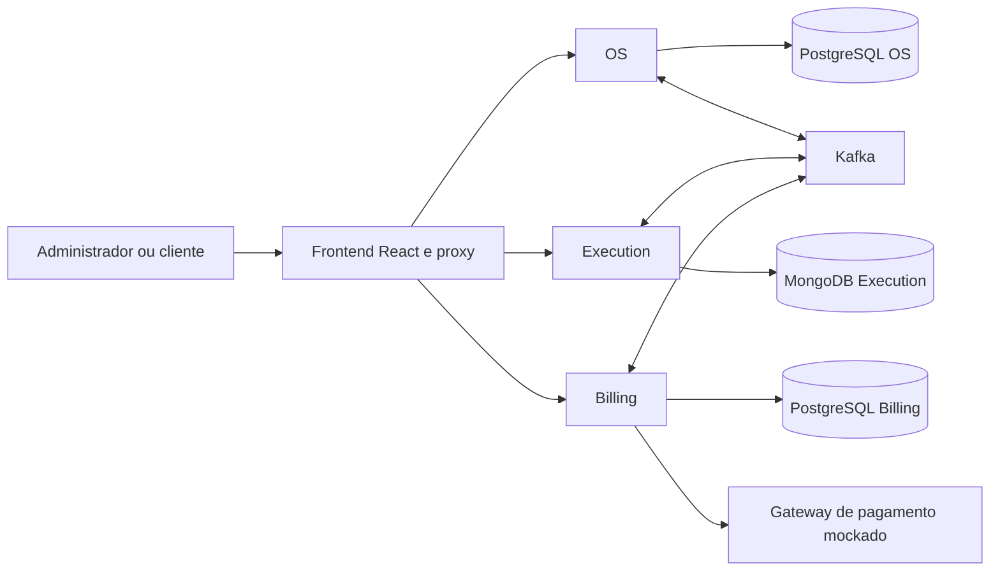

# FIAP Tech Challenge — Gestão de Oficina Mecânica

> Operação AWS atual: ciclo completo centralizado em `manage-platform.yml` no repositório principal. Bancos gerenciados (RDS/DocumentDB), Kafka no EKS, segredos e migrations são provisionados pelo fluxo. Instruções antigas de ações manuais/pré-requisitos avulsos abaixo são históricas; seguir o [guia operacional](https://github.com/Maieru/fiap-tech-challenge/blob/main/docs/operacao/plataforma-aws.md). A aplicação remota ainda exige publicação coordenada, transição e bootstrap.

Sistema para administrar clientes, veículos e o ciclo das ordens de serviço: diagnóstico, orçamento, aprovação, pagamento, execução e entrega.

Este repositório é o ponto de entrada do projeto: reúne o serviço de Ordens de Serviço (OS), o frontend e a documentação central.

## Índice

- [Inventário dos repositórios](#inventário-dos-repositórios)
- [Funcionalidades](#funcionalidades)
- [Arquitetura e responsabilidades](#arquitetura-e-responsabilidades)
- [Fluxo da ordem de serviço](#fluxo-da-ordem-de-serviço)
- [Tecnologias](#tecnologias)
- [Estrutura do repositório](#estrutura-do-repositório)
- [Documentação](#documentação)
- [Execução local integrada](#subir-os-execution-e-billing)
- [Autenticação e documentação HTTP](#autenticação-e-documentação-http)
- [Build, testes e CI](#build-testes-e-ci)
- [Observabilidade](#observabilidade)
- [Infraestrutura e Kubernetes](#infraestrutura-e-kubernetes)
- [Estado da entrega](#estado-da-entrega)
- [Objetivos do projeto](#objetivos-do-projeto)

## Inventário dos repositórios

| Repositório | Responsabilidade | Tecnologias principais |
| --- | --- | --- |
| [**fiap-tech-challenge**](https://github.com/Maieru/fiap-tech-challenge) | OS: clientes, veículos, ordens, histórico, autenticação e acompanhamento privado. Também contém o frontend e a documentação central. | .NET, PostgreSQL, Kafka, React e TypeScript |
| [**fiap-tech-challenge-execution**](https://github.com/Maieru/fiap-tech-challenge-execution) | Catálogo de serviços e peças, estoque, diagnóstico, orçamento e execução. Contratos de eventos e testes distribuídos. | .NET, MongoDB e Kafka |
| [**fiap-tech-challenge-billing**](https://github.com/Maieru/fiap-tech-challenge-billing) | Cobranças e resultados de pagamento para a Saga coordenada pelo OS. O gateway atual é mockado. | .NET, PostgreSQL e Kafka |
| [**fiap-tech-challenge-chassis**](https://github.com/Maieru/fiap-tech-challenge-chassis) | Bibliotecas técnicas de observabilidade, correlação, exceções, health checks e publicação Kafka, distribuídas por NuGet. | .NET, OpenTelemetry e NuGet |
| [**fiap-tech-challenge-infra**](https://github.com/Maieru/fiap-tech-challenge-infra) | Plataforma AWS: rede, EKS, ECR, API Gateway, infraestrutura da Lambda, add-ons, segredos e observabilidade. | Terraform, AWS, Kubernetes e Helm |
| [**fiap-tech-challenge-db**](https://github.com/Maieru/fiap-tech-challenge-db) | Provisionamento do PostgreSQL no Amazon RDS e credenciais no Secrets Manager. | Terraform, RDS e Secrets Manager |
| [**fiap-tech-challenge-serverless**](https://github.com/Maieru/fiap-tech-challenge-serverless) | Código, testes e publicação da Lambda Authorizer do acesso legado às ordens. O acompanhamento privado atual é validado pelo OS. | .NET e AWS Lambda |

OS, Execution e Billing possuem bancos próprios e se integram por eventos Kafka. Os contratos de eventos e o chassi são consumidos como pacotes NuGet; cada serviço mantém suas regras de negócio e persistência.

## Funcionalidades

- Cadastro e autenticação de usuários administrativos com JWT.
- Gestão de clientes e veículos, com edição e exclusão lógica para preservar o histórico.
- Catálogo de serviços, peças e insumos, com controle de estoque.
- Abertura de ordens com cliente e veículo existentes ou cadastrados durante o atendimento.
- Diagnóstico, composição do orçamento e preservação dos dados e valores dos itens.
- Aprovação ou cancelamento pelo administrador ou pelo link privado do cliente.
- Coordenação do pagamento e da execução por eventos, incluindo compensação por recusa.
- Registro da conclusão dos serviços, finalização da ordem e entrega administrativa.
- Acompanhamento privado do andamento e do orçamento da ordem.
- Interface administrativa responsiva, documentação HTTP e telemetria.

## Arquitetura e responsabilidades

O frontend usa as três APIs por um proxy na mesma origem. OS concentra o atendimento e coordena o fluxo da ordem; Execution mantém catálogo, estoque e execução; Billing registra cobranças e informa o resultado do pagamento.



No OS, as responsabilidades são separadas em camadas:

| Camada | Responsabilidade |
| --- | --- |
| API | Endpoints HTTP, autenticação, OpenAPI e composição da aplicação. |
| Application | Casos de uso, coordenação das operações e contratos de entrada e saída. |
| Domain | Entidades, value objects, regras e contratos do domínio. |
| Infrastructure | EF Core, PostgreSQL, repositórios, segurança e consumo Kafka. |
| Application.Messaging | Contratos públicos dos eventos do OS, distribuídos por NuGet. |

Cada serviço altera somente seu próprio banco. As confirmações Kafka atualizam as projeções do OS; decisões de aprovação e cancelamento retornam HTTP 202 enquanto o processamento distribuído continua. A publicação direta e o commit do banco não formam uma transação atômica: entregas incertas podem exigir reconciliação. Consulte o [padrão de mensageria](docs/arquitetura/mensageria.md).

## Fluxo da ordem de serviço

```text
Recebida → EmDiagnostico → AguardandoAprovacao → EmExecucao → Finalizada → Entregue
                                  │
                                  └→ Cancelada
```

1. O OS abre a ordem e publica o evento para o Execution.
2. Execution realiza o diagnóstico, vincula serviços e peças e envia o orçamento ao OS.
3. O administrador ou cliente aprova pelo acesso autorizado à ordem, ou solicita seu cancelamento.
4. Na aprovação, o OS solicita o pagamento ao Billing. A confirmação autoriza o Execution; a recusa inicia a compensação e a devolução de estoque.
5. Execution conclui os serviços e informa a finalização ao OS.
6. O administrador registra a entrega no OS.

O status operacional é preservado enquanto uma decisão está pendente. A aprovação não comprova pagamento nem início imediato da execução. A entrega exige ordem finalizada; depois da aprovação, o cancelamento por recusa de pagamento segue o fluxo de compensação. Detalhes em [Saga de pagamento](docs/arquitetura/saga-pagamento.md) e [acompanhamento e entrega](docs/arquitetura/acompanhamento-e-entrega.md).

## Tecnologias

| Área | Tecnologias |
| --- | --- |
| Backend | .NET 10, ASP.NET Core, Entity Framework Core, Npgsql e driver MongoDB. |
| Frontend | React 19, TypeScript, Vite, Tailwind CSS, Axios e Nginx. |
| Dados e integração | PostgreSQL, MongoDB com transações, Apache Kafka e contratos NuGet. |
| Segurança | JWT, BCrypt e tokens privados de acompanhamento com hash persistido. |
| Testes e qualidade | NUnit, Moq, Reqnroll, Testcontainers, cobertura, ESLint e SonarQube Cloud. |
| Execução e infraestrutura | Docker Compose, Terraform, AWS, Kubernetes, Helm e GitHub Actions com OIDC. |
| Documentação e observabilidade | Scalar, OpenAPI, OpenTelemetry e New Relic. |

## Estrutura do repositório

| Conteúdo | Onde encontrar |
| --- | --- |
| OS, contratos e testes | [Backend.slnx](Backend.slnx) e projetos `src/FIAP.TechChallenge.OS.*` — [guia do OS](docs/operacao/os-service.md) |
| Frontend administrativo e acompanhamento do cliente | [Frontend React](src/FIAP.TechChallenge.Fase1.Frontend/README.md) |
| Ambiente integrado local e OS isolado | [compose.yaml](compose.yaml) e [compose.os.yaml](compose.os.yaml) |
| Arquitetura, operação e decisões | [docs](docs/README.md) |
| Kubernetes do frontend | [k8s](k8s/README.md) |
| Referência dos manifests AWS antigos | [legacy/aws](legacy/aws/README.md) |

```text
.
├── Backend.slnx                    # solução OS: nove projetos
├── Dockerfile                      # imagem do OS
├── compose.yaml                    # frontend, três APIs e dependências
├── compose.os.yaml                 # OS isolado
├── compose.observability.yaml      # Collector opcional
├── .github/                        # workflows e verificações
├── docs/                           # arquitetura, operação, RFCs e ADRs
├── k8s/frontend/                   # configuração para implantação futura
├── legacy/aws/                     # referência dos manifests antigos
└── src/
    ├── FIAP.TechChallenge.OS.*/    # camadas, contratos e testes do OS
    ├── FIAP.TechChallenge.Fase1.Frontend/
    ├── ObservabilityConfig/
    └── TechChallengeFase1.slnx     # alias da solução OS para Visual Studio
```

Os repositórios Execution, Billing e Chassis mantêm suas próprias soluções, testes e pipelines. Abra [Backend.slnx](Backend.slnx) para trabalhar no backend deste repositório. Os diretórios `artifacts`, `bin` e `obj` são gerados localmente.

## Documentação

| Para consultar | Guia |
| --- | --- |
| Entregas e próximos passos | [Estado da migração](docs/arquitetura/estado-da-migracao.md) |
| Arquitetura e integração | [Arquitetura](docs/arquitetura/README.md), [mensageria](docs/arquitetura/mensageria.md) e [Saga de pagamento](docs/arquitetura/saga-pagamento.md) |
| Autenticação e acesso do cliente | [Autenticação OS](docs/arquitetura/autenticacao-os.md) e [acompanhamento e entrega](docs/arquitetura/acompanhamento-e-entrega.md) |
| Frontend local e na nuvem | [Configuração](src/FIAP.TechChallenge.Fase1.Frontend/README.md) e [integração com microsserviços](docs/arquitetura/migracao-frontend.md) |
| Build, testes e dependências | [CI e pacotes NuGet](docs/operacao/monorepo-ci.md) e [validação ponta a ponta](docs/operacao/validacao-ponta-a-ponta.md) |
| Infraestrutura e operação | [CI/CD](docs/operacao/ci-cd.md), [Kubernetes](k8s/README.md) e [observabilidade](docs/operacao/observabilidade.md) |
| Decisões técnicas e arquiteturais | [RFCs](docs/RFCs/README.md) e [ADRs](docs/ADRs/README.md) |

## Subir OS, Execution e Billing

Requer Docker com Compose e containers Linux, com as portas 5173 e 8081–8083 disponíveis. O Compose constrói as imagens e inicia os bancos e o Kafka. Mantenha estes três checkouts lado a lado:

Para preparar uma pasta de trabalho nova, clone os repositórios com os nomes usados pelo Compose:

```powershell
git clone https://github.com/Maieru/fiap-tech-challenge.git FiapTechChallengeFase1
git clone https://github.com/Maieru/fiap-tech-challenge-execution.git FiapTechChallengeExecution
git clone https://github.com/Maieru/fiap-tech-challenge-billing.git FiapTechChallengeBilling
```

A organização resultante será:

```text
FiapTechChallenge/
├── FiapTechChallengeFase1/       # este repositório
├── FiapTechChallengeExecution/
└── FiapTechChallengeBilling/
```

Na raiz de `FiapTechChallengeFase1`, prepare a configuração de um checkout novo:

```powershell
Copy-Item .env.example .env
```

Preencha `OS_DB_PASSWORD`, `BILLING_DB_PASSWORD` e `JWT_SIGNING_KEY` no `.env`. A chave JWT deve ter pelo menos 32 bytes; issuer, audience e chave são compartilhados pelas três APIs. Preserve o `.env` de ambientes já configurados.

```powershell
docker compose up -d --build
```

| Componente | Endereço local |
| --- | --- |
| Frontend | [localhost:5173](http://localhost:5173) |
| API OS — Scalar | [localhost:8081/scalar/v1](http://localhost:8081/scalar/v1) |
| API Execution — Scalar | [localhost:8082/scalar/v1](http://localhost:8082/scalar/v1) |
| API Billing — Scalar | [localhost:8083/scalar/v1](http://localhost:8083/scalar/v1) |

Cadastre um usuário na tela de login. Os bancos e usuários do monólito não são importados automaticamente. O ambiente local funciona sem API Gateway. Para encerrar preservando os volumes, execute `docker compose down`.

Comandos de acompanhamento, na mesma pasta:

```powershell
docker compose ps -a
docker compose logs -f
docker compose down
```

Migrations e tópicos são inicializados pela stack. Não altere senhas de bancos com volumes existentes sem atualizar também as credenciais no banco. Os consumidores encerram em falhas técnicas; consulte os logs e o [roteiro de recuperação](docs/arquitetura/mensageria.md) antes de reiniciar ou reenviar mensagens.

### Trabalhar somente no OS

O ambiente isolado usa o `.env` da raiz e banco/Kafka próprios. Pare ambientes que disputem as mesmas portas antes de iniciá-lo:

```powershell
docker compose -f compose.os.yaml up -d --build
```

Para executar a API pelo SDK .NET 10, configure `ConnectionStrings__DefaultConnection`, `Kafka__BootstrapServers`, `Jwt__Issuer`, `Jwt__Audience` e `Jwt__SigningKey` no ambiente, com banco e Kafka acessíveis. Defina `Database__ApplyMigrations=true` para aplicar migrations na inicialização local, ou aplique-as com `dotnet ef`. Execute:

```powershell
$env:ASPNETCORE_ENVIRONMENT = 'Development'
dotnet run --project src/FIAP.TechChallenge.OS.API --no-launch-profile --urls http://localhost:8081
```

Esse comando usa a porta 8081 esperada pelo frontend; encerre a API OS em Docker antes de ocupar a mesma porta. O perfil de inicialização do Visual Studio pode usar outras portas. O comando pelo SDK não carrega o `.env` do Compose: configure as variáveis no processo antes de executá-lo.

As ferramentas `dotnet ef` também exigem a variável de conexão; não carregam o `.env` automaticamente. Exemplos e opções estão no [guia do OS](docs/operacao/os-service.md).

### Desenvolver o frontend com Vite

Requer Node.js 22.12+ ou versão posterior compatível. Com as três APIs iniciadas nas portas locais indicadas:

```powershell
cd src/FIAP.TechChallenge.Fase1.Frontend
npm ci --ignore-scripts
npm run dev
```

Vite encaminha os prefixos `/api/os/v1`, `/api/execution/v1` e `/api/billing/v1` às APIs. Na imagem Docker, Nginx faz esse encaminhamento. Os destinos podem ser configurados para serviços locais ou um gateway separado; veja o [guia do frontend](src/FIAP.TechChallenge.Fase1.Frontend/README.md).

## Autenticação e documentação HTTP

O OS emite o JWT administrativo, aceito pelas três APIs:

1. Cadastre um usuário em `POST /api/os/v1/usuarios` ou pela tela de login.
2. Autentique em `POST /api/os/v1/usuarios/login`.
3. Envie `Authorization: Bearer <token>` nas chamadas administrativas.

Não há usuário ou senha padrão. O cadastro administrativo permanece anônimo por decisão do projeto. O cliente acessa somente a ordem autorizada pelo link privado emitido pelo administrador; o OS valida seu token e persiste apenas o hash. A Lambda Authorizer legada não participa desse fluxo. Consulte os [limites de autenticação](docs/arquitetura/autenticacao-os.md).

Scalar fica em `/scalar/v1` e OpenAPI em `/openapi/v1.json` em cada API, nos ambientes Development e Testing. Chamadas administrativas realizadas pelo Scalar também exigem JWT. O OS expõe `/api/os/v1/health/live` e `/api/os/v1/health/ready`; a readiness verifica suas dependências.

## Build, testes e CI

Com .NET SDK 10 e Docker disponíveis, execute na raiz:

```powershell
dotnet restore Backend.slnx
dotnet build Backend.slnx -c Release --no-restore
dotnet test Backend.slnx -c Release --no-build --no-restore --filter 'TestCategory!=ContainerImage'
```

A solução inclui testes de domínio, casos de uso, contratos e integração HTTP/PostgreSQL/Kafka. Os testes de integração usam containers e dados isolados. Para verificar também a imagem OS:

```powershell
docker build -t fiap-os:local .
$env:OS_TEST_IMAGE = 'fiap-os:local'
dotnet test src/FIAP.TechChallenge.OS.Integration.Tests -c Release --no-build --no-restore --filter 'TestCategory=ContainerImage'
```

No diretório do frontend:

```powershell
npm test
npm run lint:ci
npm run build
```

O GitHub Actions verifica OS, cobertura, imagem, frontend e segurança do proxy Nginx. O check `ci-required` exige sucesso desses jobs e do Sonar. O frontend está excluído da análise Sonar, mas mantém testes, lint e build no CI. O lint do CI tem escopo definido; não equivale à validação de todas as telas pelo lint global.

Os cenários distribuídos entre OS, Execution e Billing ficam no repositório [Execution](https://github.com/Maieru/fiap-tech-challenge-execution). Consulte [validação ponta a ponta](docs/operacao/validacao-ponta-a-ponta.md), [verificação do frontend](docs/operacao/validacao-frontend.md) e [CI e publicação NuGet](docs/operacao/monorepo-ci.md).

## Observabilidade

O chassi padroniza logs, traces, métricas e correlação. OpenTelemetry Collector encaminha a telemetria ao New Relic. O ambiente integrado pode iniciar sem o Collector; para usá-lo, configure `NEW_RELIC_LICENSE_KEY` no ambiente ou `.env` e execute:

```powershell
docker compose -f compose.observability.yaml up -d
```

Habilite a exportação dos serviços desejados conforme o [guia de observabilidade](docs/operacao/observabilidade.md). As [métricas de negócio](docs/operacao/metricas-negocio.md) e a [configuração dos dashboards](docs/operacao/dashboard-new-relic.md) detalham os sinais e consultas disponíveis.

## Infraestrutura e Kubernetes

A plataforma AWS é mantida nos repositórios Infra, DB e Serverless do inventário. Eles separam rede/plataforma, RDS e código da Lambda. Terraform, estados remotos, OIDC, EKS, ECR, API Gateway e segredos fazem parte dessa infraestrutura.

A árvore ativa contém [OS](k8s/os/README.md) e frontend; Execution e Billing mantêm seus manifestos nos próprios repositórios. Cada API usa Service ClusterIP em HTTP 8080, HPA de 1 a 3 réplicas, credencial exclusiva de banco e OpenTelemetry habilitado. HTTPS permanece na entrada pública; o frontend não exige Secret de CA interna. Bancos, Kafka, imagens, segredos/IAM e migrations prévias são pré-requisitos do [guia de implantação](k8s/README.md).

Os manifests do backend antigo ficam em `legacy/aws` como referência. Os workflows exclusivos de deploy do monólito foram removidos; o CI atual não implanta automaticamente os microsserviços na AWS. A ordem de provisionamento, migração de tráfego, validação do gateway e retirada dos recursos antigos deve seguir os [guias de CI/CD](docs/operacao/ci-cd.md) e de [retirada do monólito](docs/arquitetura/retirada-monolito.md).

As Actions manuais [publish-image e deploy-eks](scripts/delivery/README.md) permitem publicar OS/frontend no ECR e aplicar seus manifestos no EKS. Execution e Billing têm os mesmos workflows em seus repositórios, com roles OIDC próprias, CI aprovado e deploy por digest. O Infra declara os ECRs, identidades e RBAC necessários; seus applies e a configuração das variáveis precisam ser concluídos antes de usar as Actions.

## Estado da entrega

Os três serviços e o frontend estão integrados e possuem testes e builds próprios. O código do monólito foi retirado deste checkout; sua recuperação está descrita no [guia de retirada](docs/arquitetura/retirada-monolito.md).

A implantação dos microsserviços na AWS, a migração de tráfego e dados e a retirada dos recursos legados são etapas operacionais próprias. Os pré-requisitos e limites atuais estão no [estado da migração](docs/arquitetura/estado-da-migracao.md).

## Objetivos do projeto

O projeto reúne a implementação e a operação de uma aplicação de oficina para exercitar:

- Modelagem com DDD, domínio rico e regras de negócio protegidas dos detalhes de infraestrutura.
- Separação de responsabilidades entre camadas, serviços e bancos de dados.
- Integração assíncrona por eventos e coordenação do ciclo de atendimento.
- Testes automatizados com APIs, bancos e mensageria reais em ambientes isolados.
- Conteinerização, infraestrutura como código, entrega contínua e observabilidade.
- Uma experiência completa, do atendimento administrativo ao acompanhamento pelo cliente.
