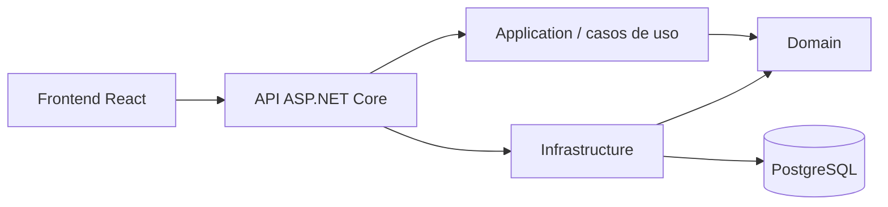

# Sistema de Gestão de Oficina Mecânica

Aplicação para administrar o ciclo operacional de uma oficina mecânica. A solução reúne uma API em .NET, um frontend React, persistência em PostgreSQL, ambiente local com Docker Compose e infraestrutura AWS provisionada com Terraform e Kubernetes.

## Primeiro incremento da Fase 4

O monorepo inclui um [OS Service independente](src/Services/OrdensServico/README.md), com PostgreSQL exclusivo e gestão de clientes/veículos (edição e soft delete). O monólito e suas rotas continuam disponíveis. O [chassi técnico](https://github.com/Maieru/fiap-tech-challenge-chassis) possui repositório, testes e publicação NuGet próprios.

Abra [OrdensServico.slnx](src/Services/OrdensServico/OrdensServico.slnx) para os nove projetos do OS, incluindo contratos de mensageria e seus testes. `Backend.slnx` mantém a visão integrada dos 18 projetos do legado e do OS. Build, testes, cobertura e Sonar são orquestrados pelo GitHub Actions.

Legado e OS usam `Maieru.FiapTechChallenge.Chassis` **0.1.0** por `PackageReference`. O restore em ambiente limpo exige que essa versão esteja publicada no NuGet.org; este repositório não prepara pacotes candidatos nem utiliza feed local do chassi.

Consulte [arquitetura e reaproveitamento](docs/arquitetura/fase4-incremento1.md), [CI e configuração de contas externas](docs/operacao/monorepo-ci.md) e [evidências de testes](docs/operacao/evidencias-fase4-incremento1.md). O pacote foi validado localmente; publicação no NuGet.org e análise SonarQube Cloud dependem das contas externas. AWS/Saga/mensageria e migração de tráfego do novo serviço ficam para os próximos incrementos.

## Ecossistema de repositórios

O [Execution — etapa 2](docs/arquitetura/execution.md) já possui implementação local em repositório próprio,
com MongoDB, catálogo, estoque, diagnóstico e execução. A integração Kafka completa da API OS será a próxima etapa;
o fluxo atual do legado permanece disponível.

O projeto está distribuído por responsabilidade entre os seguintes repositórios:

| Repositório | Responsabilidade |
| --- | --- |
| [`fiap-tech-challenge`](https://github.com/Maieru/fiap-tech-challenge) | Aplicação principal: API .NET, frontend React, testes, Docker Compose, manifests das aplicações e orquestração dos workflows. |
| [`fiap-tech-challenge-chassis`](https://github.com/Maieru/fiap-tech-challenge-chassis) | Biblioteca técnica, testes, exemplo consumidor e publicação NuGet com CI/Sonar próprios. |
| [`fiap-tech-challenge-infra`](https://github.com/Maieru/fiap-tech-challenge-infra) | Infraestrutura compartilhada: backend do Terraform, VPC, EKS, ECR, add-ons, configurações Kubernetes, observabilidade, API Gateway e infraestrutura da Lambda Authorizer. |
| [`fiap-tech-challenge-db`](https://github.com/Maieru/fiap-tech-challenge-db) | Infraestrutura do PostgreSQL no Amazon RDS e credenciais do banco no AWS Secrets Manager. |
| [`fiap-tech-challenge-serverless`](https://github.com/Maieru/fiap-tech-challenge-serverless) | Código, testes e publicação da Lambda Authorizer de acesso às ordens. |

## Funcionalidades

- autenticação de usuários com JWT;
- cadastro e gestão de clientes e veículos;
- catálogo de serviços, peças e insumos, com controle de estoque;
- criação de ordens de serviço com cliente e veículo existentes ou cadastrados no próprio fluxo;
- diagnóstico, orçamento, aprovação, execução, finalização, entrega e cancelamento de ordens de serviço;
- acompanhamento público do andamento da ordem de serviço;
- registro do tempo gasto e cálculo do tempo médio dos serviços;
- exclusão lógica para preservação do histórico;
- interface administrativa responsiva para operação dos principais fluxos.

## Arquitetura e decisões técnicas

O catálogo em [`docs/README.md`](docs/README.md) reúne a visão visual da arquitetura, as RFCs de escolhas técnicas e os ADRs das decisões arquiteturais permanentes.

Consulte os [diagramas de sequência](docs/arquitetura/sequencias.md), o [modelo ER e sua evolução](docs/arquitetura/banco-de-dados.md) e o [fluxo de CI/CD](docs/operacao/ci-cd.md). Cada guia distingue o comportamento atual das pendências de implementação.

O backend legado é um monólito organizado em camadas, com as regras de negócio isoladas dos detalhes de persistência e entrega HTTP. O OS Service segue a mesma separação em projetos próprios; o diagrama abaixo representa o legado:



- **API:** controllers, autenticação, OpenAPI e composição da aplicação;
- **Application:** casos de uso e contratos de entrada e saída;
- **Domain:** entidades, value objects, enums, interfaces e regras de negócio;
- **Infrastructure:** Entity Framework Core, repositórios, migrations, JWT e serviços externos;
- **Frontend:** aplicação React com rotas protegidas, consumo da API e telas administrativas.

A API aplica automaticamente as migrations pendentes na inicialização, exceto no ambiente de testes.

## Tecnologias

- .NET 10, ASP.NET Core e Entity Framework Core;
- PostgreSQL e Npgsql;
- JWT e BCrypt;
- React 19, TypeScript, Vite e Tailwind CSS;
- Docker, Docker Compose e Nginx;
- Terraform, AWS, API Gateway, Application Load Balancer e Kubernetes;
- Scalar e OpenAPI;
- NUnit, Moq e FluentAssertions.

## Execução local com Docker Compose

### Pré-requisitos

- Docker com Docker Compose;
- portas `5173`, `8080`, `5050`, `5432`, `4317` e `4318` disponíveis.

Copie `src/.env.example` para `src/.env` e preencha `NEW_RELIC_LICENSE_KEY`, conforme o [guia de observabilidade](docs/operacao/observabilidade.md). O Compose atual exige esse valor para iniciar. Depois, na raiz do repositório, execute:

```bash
docker compose -f src/docker-compose.yml up --build -d
```

Serviços disponíveis:

| Serviço | Endereço | Credenciais locais |
| --- | --- | --- |
| Frontend | `http://localhost:5173` | — |
| API | `http://localhost:8080` | — |
| Scalar | [Interface da API](http://localhost:8080/scalar/v1) | — |
| OpenAPI | [Contrato JSON](http://localhost:8080/openapi/v1.json) | — |
| Liveness | `http://localhost:8080/api/health/live` | — |
| Readiness | `http://localhost:8080/api/health/ready` | — |
| PostgreSQL | `localhost:5432` | `postgres / postgres` |
| PgAdmin | `http://localhost:5050` | `admin@admin.com / admin` |

As credenciais e chaves presentes no Compose são destinadas apenas ao desenvolvimento local.

Para encerrar os serviços:

```bash
docker compose -f src/docker-compose.yml down
```

## Execução sem Docker

### Backend

Requer o SDK .NET 10 e uma instância PostgreSQL acessível. Configure `ConnectionStrings:DefaultConnection` e as opções `Jwt` por `appsettings`, variáveis de ambiente ou User Secrets e execute:

```bash
dotnet run --project src/FIAP.TechChallenge.Fase1.API --launch-profile http
```

### Frontend

Requer Node.js 22.12 ou superior na linha 22, ou uma versão posterior compatível com o Vite. A partir da raiz do repositório:

```bash
cd src/FIAP.TechChallenge.Fase1.Frontend
npm install
npm run dev
```

Para apontar o frontend para uma API executada separadamente, crie um arquivo `.env` no diretório do frontend:

```env
VITE_API_BASE_URL=http://localhost:5251/api
```

O perfil `http` do backend usa `http://localhost:5251`. Se executar a API pelo Compose, use `http://localhost:8080/api` no frontend local.

No Visual Studio, abra `src/TechChallengeFase1.slnx` para trabalhar com o legado e seu projeto Docker Compose. Selecione `docker-compose` como projeto de inicialização para subir esse ambiente. Para o backend integrado ou os componentes novos, escolha uma das soluções da tabela em [Estrutura do repositório](#estrutura-do-repositório).

## Autenticação e documentação da API

Em ambiente de desenvolvimento, a especificação OpenAPI e a interface Scalar ficam disponíveis nos endereços indicados acima.

O fluxo de autenticação é:

1. criar um usuário em `POST /api/usuarios`;
2. autenticar em `POST /api/usuarios/login`;
3. enviar o token retornado nas requisições protegidas:

```http
Authorization: Bearer <token>
```

Na API, cadastro, login, health checks, acompanhamento, aprovação e cancelamento permitem chamadas sem JWT. Na AWS, as três rotas declaradas de ordem exigem `token` na query string, validado pela Lambda Authorizer. A aprovação também valida esse token no caso de uso; acompanhamento e cancelamento dependem da proteção da borda. Os demais endpoints administrativos exigem JWT.

Conforme o alinhamento do projeto, a Lambda valida requisições de clientes usando o token SHA-256 de acesso à ordem e devolve a decisão ao gateway. A API emite o JWT da autenticação administrativa. O contrato está na [RFC-003](docs/RFCs/RFC-003-autenticacao-jwt-e-bcrypt.md).

## Fluxo da ordem de serviço

O fluxo principal de status é:

```text
Recebida → EmDiagnostico → AguardandoAprovacao → EmExecucao → Finalizada → Entregue
```

Uma ordem também pode assumir o status `Cancelada`, conforme as regras do domínio.

Regras importantes:

- serviços e peças ou insumos só podem ser adicionados durante o diagnóstico;
- a execução depende de um token gerado a partir do CPF do cliente e do código de aprovação mantido apenas no backend;
- serviços só podem ser concluídos enquanto a ordem está em execução;
- a ordem só pode ser finalizada após a conclusão de todos os serviços;
- a entrega só pode ocorrer depois da finalização;
- os itens vinculados à ordem preservam um snapshot dos dados e valores do momento da inclusão.

## Infraestrutura e Kubernetes

A infraestrutura remota de laboratório é declarada em Terraform nos repositórios [`fiap-tech-challenge-infra`](https://github.com/Maieru/fiap-tech-challenge-infra) e [`fiap-tech-challenge-db`](https://github.com/Maieru/fiap-tech-challenge-db). Ela provisiona, na região `us-east-1`, uma VPC, um cluster Amazon EKS, PostgreSQL no Amazon RDS, repositórios Amazon ECR, Secrets Manager, backend remoto no S3 e autenticação OIDC para as pipelines do GitHub Actions.

Os manifests em `k8s` implantam backend e frontend em namespaces separados. O backend possui uma réplica inicial, probes de saúde, limites de recursos e HPA de 1 a 10 pods; seus segredos são sincronizados do AWS Secrets Manager pelo External Secrets. Os dois serviços são `ClusterIP` e participam do mesmo `IngressGroup`: o AWS Load Balancer Controller cria um ALB interno que encaminha `/api/*` ao backend e as demais rotas ao frontend. Um API Gateway HTTP API é a entrada pública e acessa esse ALB por um VPC Link.

Os módulos Terraform devem ser aplicados nesta ordem:

```text
bootstrap → aws-resources → database → kubernetes-addons → kubernetes-configs
→ deploy das aplicações e Ingresses → api-gateway → serverless → código da Lambda
```

Os estágios `bootstrap`, `aws-resources`, `kubernetes-addons`, `kubernetes-configs`, `api-gateway` e `serverless` pertencem ao repositório de infraestrutura; `database` pertence ao repositório de banco. Ambos têm workflows Terraform reutilizáveis. A aplicação orquestra infraestrutura, imagens e manifests; o repositório serverless publica o código depois de a função existir.

O fluxo completo executa:

```text
Infra/Core → Database → Infra/Kubernetes → Build → Deploy/ALB
→ API Gateway → Infra/Serverless → Código da Lambda
```

Na destruição, o orquestrador preserva as dependências entre os estados:

```text
Serverless → API Gateway → Ingresses/ALB → Kubernetes Configs
→ Kubernetes Add-ons → Database → EKS
```

O passo a passo operacional está no [`guia de infraestrutura`](https://github.com/Maieru/fiap-tech-challenge-infra/tree/main/infra) e no [`guia do banco`](https://github.com/Maieru/fiap-tech-challenge-db#readme). A organização dos manifests, o deploy manual e os comandos de diagnóstico estão em [`k8s/README.md`](k8s/README.md).

Para a orquestração, configure os secrets `INFRA_ACTION_ROLE`, `DATABASE_ACTION_ROLE`, `ACTION_ROLE_ARN`, `AUTH_ACTION_ROLE`, `jwt_signing_key`, `db_username`, `db_password` e `NEW_RELIC_LICENSE_KEY`. Se os repositórios forem privados, configure também `REPOSITORIES_TOKEN` com acesso de leitura aos repositórios chamados.

No GitHub Actions, inicie `Initialize Infrastructure And Deploy` para executar o fluxo completo. O orquestrador também responde a pushes em `main` que alterem as aplicações legadas, manifests ou workflows de deploy; mudanças exclusivas de chassi/OS não provisionam a AWS. O novo OS ainda não participa desse deploy. Consulte a [documentação de CI/CD](docs/operacao/ci-cd.md) e o [CI do monorepo](docs/operacao/monorepo-ci.md).

## Testes

Os componentes têm suítes independentes. Requer .NET 10, o pacote público do chassi disponível e Docker para os testes PostgreSQL/HTTP. Na raiz do repositório, escolha o escopo:

```bash
# Todo o backend deste repositório: legado e OS
dotnet test Backend.slnx -c Release --filter 'TestCategory!=ContainerImage'

# Somente o legado, incluindo integração PostgreSQL e BDD
dotnet test Legacy.slnx -c Release
```

Os comandos específicos do [OS](src/Services/OrdensServico/README.md) estão em seu guia. O teste de imagem, categoria `ContainerImage`, exige construir a imagem e definir `OS_TEST_IMAGE`; consulte o [procedimento](src/Services/OrdensServico/README.md#testes-e-imagem). Os testes do chassi ficam em seu próprio repositório.

## Estrutura do repositório

```text
.
├── Backend.slnx             # visão integrada, agrupada por componente
├── Legacy.slnx              # backend legado e seus testes
├── .github/
│   ├── actions/             # gate de cobertura por componente
│   └── workflows/           # CI, Sonar e orquestração AWS
├── docs/                    # guias de arquitetura/operação, RFCs e ADRs
├── k8s/                     # manifests das aplicações legadas
└── src/
    ├── Services/
    │   └── OrdensServico/   # OS, testes, Dockerfile, Compose e solução própria
    ├── FIAP.TechChallenge.Fase1.*/  # projetos legados e frontend
    ├── LoadTests/           # cenários de carga do legado
    ├── ObservabilityConfig/ # Collector do ambiente local legado
    ├── TechChallengeFase1.slnx     # legado com integração Docker no Visual Studio
    └── docker-compose.yml  # ambiente local legado
```

| Escopo de trabalho | Solução | Projetos |
| --- | --- | ---: |
| Backend integrado | [Backend.slnx](Backend.slnx) | 16 |
| Backend legado e testes | [Legacy.slnx](Legacy.slnx) | 9 |
| OS Service e testes | [OrdensServico.slnx](src/Services/OrdensServico/OrdensServico.slnx) | 7 |
| Legado com Docker no Visual Studio | [TechChallengeFase1.slnx](src/TechChallengeFase1.slnx) | 9 .NET + Docker Compose |

Os agrupamentos das soluções são visuais; os diretórios físicos são preservados. `artifacts/`, `bin/`, `obj/` e resultados de testes são gerados e não devem ser versionados. `coverage.runsettings` na raiz padroniza a coleta dos componentes.

## Observações Finais

Este projeto foi construído com foco em:

- aplicar princípios de DDD na modelagem do domínio;
- manter uma separação clara de responsabilidades entre as camadas;
- experimentar, na prática, o conceito de domínio rico;
- proteger as regras de negócio dos detalhes de infraestrutura e apresentação;
- oferecer uma experiência completa, da interface administrativa à persistência dos dados;
- facilitar a execução local, os testes, a avaliação e a evolução futura do sistema;
- aplicar infraestrutura como código e automatizar o provisionamento e o deploy;
- explorar a execução em nuvem com AWS e a orquestração de aplicações com Kubernetes.

Este é meu primeiro projeto em que aplico esses conceitos de forma tão abrangente, cobrindo não apenas a modelagem e a implementação da aplicação, mas também frontend, conteinerização, infraestrutura e entrega contínua.

## Observabilidade

A telemetria é enviada ao New Relic via OpenTelemetry Collector. Antes de iniciar o Docker Compose, configure a chave em `src/.env` conforme o [guia de observabilidade](docs/operacao/observabilidade.md).

## Métricas de negócio

Consulte [as métricas OpenTelemetry e consultas dos dashboards New Relic](docs/operacao/metricas-negocio.md).
