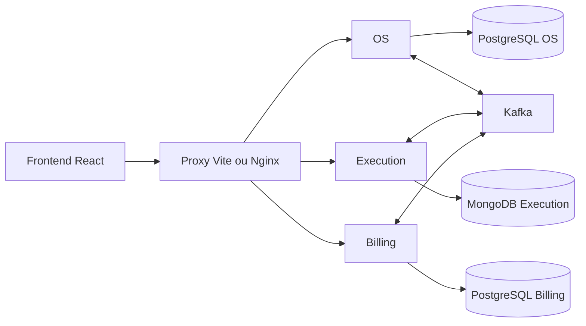

# Sistema de Gestão de Oficina Mecânica

Aplicação para administrar o ciclo operacional de uma oficina mecânica. A solução usa microsserviços .NET, com frontend React, PostgreSQL, MongoDB e Kafka. Possui ambientes locais com Docker Compose e infraestrutura do legado definida para AWS com Terraform e Kubernetes.

## Migração para microsserviços

O monorepo inclui um [OS Service independente](docs/operacao/os-service.md), com PostgreSQL exclusivo, gestão de clientes/veículos e ordens, integrado ao Execution por Kafka. O código do monólito foi retirado do checkout; o frontend utiliza os três microsserviços. Os recursos AWS antigos permanecem sujeitos a retirada operacional separada. O [chassi técnico](https://github.com/Maieru/fiap-tech-challenge-chassis) possui repositório, testes e publicação NuGet próprios.

Abra [Backend.slnx](Backend.slnx) para os nove projetos do OS, diretamente em `src`, incluindo contratos de mensageria e testes. `src/TechChallengeFase1.slnx` é um alias para Visual Studio com os mesmos projetos. Build, testes, cobertura e Sonar são orquestrados pelo GitHub Actions.

O OS usa `Maieru.FiapTechChallenge.Chassis` **1.1.1**, com adaptador Kafka **0.1.1**, por `PackageReference`.
Consulta ao feed em 2026-11-02: contratos OS **0.2.0** e Execution **0.1.0** disponíveis; contratos Billing **0.1.0**, consumidos pelo OS, ainda precisam de publicação ou restore local explícito. Consulte [dependências e publicação](docs/operacao/monorepo-ci.md).

Consulte o [estado atual da migração](docs/arquitetura/estado-da-migracao.md) para o que foi entregue e o que permanece pendente. Billing com gateway mockado, Saga, acompanhamento privado e entrega administrativa estão implementados. O frontend foi migrado e verificado localmente. O código, Compose e automação exclusiva do monólito foram retirados. Gateway de pagamento real, implantação dos novos serviços e retirada dos recursos/dados legados permanecem pendentes. Ver [escopo da retirada](docs/arquitetura/retirada-monolito.md). O [guia do frontend](docs/arquitetura/migracao-frontend.md) detalha contratos, proxies e limites da validação. A configuração de build e dependências está no [guia de CI](docs/operacao/monorepo-ci.md).

## Subir OS, Execution e Billing

Na raiz deste repositório, com Docker Desktop em modo Linux e os checkouts `FiapTechChallengeExecution` e `FiapTechChallengeBilling` ao lado de `FiapTechChallengeFase1`:

```powershell
docker compose up -d --build
```

O `compose.yaml` da raiz constrói frontend e três APIs e inicia seus dois PostgreSQL, MongoDB replica set e Kafka. Acesse o frontend em http://localhost:5173 e cadastre um usuário na tela de login. Tópicos e migrations são inicializados pelas dependências. OS fica em http://localhost:8081/scalar/v1, Execution em http://localhost:8082/scalar/v1 e Billing em http://localhost:8083/scalar/v1. Os consumidores não reiniciam automaticamente após falha.

Na primeira configuração de um checkout novo, copie `.env.example` para `.env` e preencha as senhas e `JWT_SIGNING_KEY` (pelo menos 32 bytes). OS emite os tokens administrativos; issuer/audience/chave devem coincidir nos três serviços. O arquivo `.env` é ignorado pelo Git. Nesta migração do comando anterior, a configuração local existente foi reaproveitada, sem regenerar credenciais. Não troque senhas de bancos com volumes existentes sem atualizar os bancos correspondentes.

Enquanto Billing Messaging 0.1.0 não estiver publicado no NuGet, prepare esse candidato com .NET SDK 10, nesta mesma pasta:

```powershell
dotnet pack src/FIAP.TechChallenge.OS.Application.Messaging -c Release -o ../FiapTechChallengeBilling/artifacts/packages
dotnet pack ../FiapTechChallengeBilling/src/FIAP.TechChallenge.Billing.Application.Messaging -c Release -o artifacts/packages
```

O Dockerfile OS consome esse feed local; Billing já pode restaurar OS Messaging 0.2.0 do NuGet público. Depois da publicação do contrato Billing, o restore público atende aos builds sem essa preparação. Consulte o [guia de restore e publicação](docs/operacao/monorepo-ci.md).

```powershell
docker compose ps -a       # Estado dos serviços
docker compose logs -f    # Acompanhar logs
docker compose down       # Parar preservando os volumes
```

O projeto continua chamado `fiap-integrated`, com os mesmos volumes do comando anterior. `compose.yaml` reúne os três serviços e o frontend; `compose.os.yaml`, na raiz, atende ao OS isolado com o projeto `fiap-os`. Pare outros ambientes que utilizem as mesmas portas antes de iniciar. O OS oferece cadastro/login próprios em `/api/os/v1/usuarios` e `/api/os/v1/usuarios/login`; o frontend migrado faz parte desta stack e usa proxy same-origin sem exigir Kong.

## Documentação HTTP com Scalar

As APIs já registram OpenAPI e Scalar. Com a stack integrada iniciada:

| API | Scalar | OpenAPI |
| --- | --- | --- |
| OS | http://localhost:8081/scalar/v1 | http://localhost:8081/openapi/v1.json |
| Execution | http://localhost:8082/scalar/v1 | http://localhost:8082/openapi/v1.json |
| Billing | http://localhost:8083/scalar/v1 | http://localhost:8083/openapi/v1.json |

O endereço antigo na porta 8080 não faz parte da stack atual. O authorizer Lambda legado não integra o acesso privado novo, validado pelo próprio OS.

Scalar/OpenAPI ficam habilitados em `Development`; OS, Execution e Billing também os habilitam em `Testing`. O Compose integrado usa `Development`. A autenticação JWT dos endpoints administrativos permanece exigida nas chamadas realizadas pela documentação.

Scalar e OpenAPI foram verificados localmente com HTTP 200 nas três APIs. As especificações acompanham as rotas atuais; consulte as [evidências ponta a ponta](docs/operacao/validacao-ponta-a-ponta.md).

## Ecossistema de repositórios

O [Execution](docs/arquitetura/execution.md) possui repositório próprio, com MongoDB, catálogo, estoque, diagnóstico e execução. A integração Kafka entre OS, Billing e Execution e os testes distribuídos das três APIs estão implementados. Isso não representa migração do tráfego nem implantação dos novos serviços na AWS.

O projeto está distribuído por responsabilidade entre os seguintes repositórios:

| Repositório | Responsabilidade |
| --- | --- |
| [`fiap-tech-challenge`](https://github.com/Maieru/fiap-tech-challenge) | OS Service, frontend React e documentação central, com testes, imagens e workflows. |
| [`fiap-tech-challenge-execution`](https://github.com/Maieru/fiap-tech-challenge-execution) | Execution, MongoDB, integração Kafka, contratos NuGet e testes próprios e distribuídos. |
| [`fiap-tech-challenge-billing`](https://github.com/Maieru/fiap-tech-challenge-billing) | Billing, PostgreSQL exclusivo, gateway mockado, contratos NuGet e testes próprios. |
| [`fiap-tech-challenge-chassis`](https://github.com/Maieru/fiap-tech-challenge-chassis) | Biblioteca técnica, testes, exemplo consumidor e publicação NuGet com CI/Sonar próprios. |
| [`fiap-tech-challenge-infra`](https://github.com/Maieru/fiap-tech-challenge-infra) | Infraestrutura compartilhada: backend do Terraform, VPC, EKS, ECR, add-ons, configurações Kubernetes, observabilidade, API Gateway e infraestrutura da Lambda Authorizer. |
| [`fiap-tech-challenge-db`](https://github.com/Maieru/fiap-tech-challenge-db) | Infraestrutura do PostgreSQL no Amazon RDS e credenciais do banco no AWS Secrets Manager. |
| [`fiap-tech-challenge-serverless`](https://github.com/Maieru/fiap-tech-challenge-serverless) | Código, testes e publicação da Lambda Authorizer de acesso às ordens. |

## Funcionalidades

O frontend integrado aos microsserviços oferece as funcionalidades abaixo. A distribuição entre os serviços e as pendências de implantação estão no [estado da migração](docs/arquitetura/estado-da-migracao.md).

- autenticação de usuários com JWT;
- cadastro e gestão de clientes e veículos;
- catálogo de serviços, peças e insumos, com controle de estoque;
- criação de ordens de serviço com cliente e veículo existentes ou cadastrados no próprio fluxo;
- diagnóstico, orçamento, aprovação, execução, finalização, entrega e cancelamento de ordens de serviço;
- acompanhamento privado do andamento e decisões da ordem por link;
- registro do tempo gasto e cálculo do tempo médio dos serviços;
- exclusão lógica de cadastros para preservação do histórico, sem ação de exclusão de ordens no frontend migrado;
- interface administrativa responsiva para operação dos principais fluxos.

## Arquitetura e decisões técnicas

O catálogo em [`docs/README.md`](docs/README.md) reúne a visão visual da arquitetura, as RFCs de escolhas técnicas e os ADRs das decisões arquiteturais permanentes.

Consulte os [diagramas de sequência](docs/arquitetura/sequencias.md), o [modelo ER e sua evolução](docs/arquitetura/banco-de-dados.md) e o [fluxo de CI/CD](docs/operacao/ci-cd.md). Cada guia distingue o comportamento atual das pendências de implementação.

OS, Execution e Billing preservam camadas próprias e dados exclusivos. O frontend acessa os três prefixos por um proxy local ou pela borda em nuvem. A comunicação entre serviços usa Kafka:



- **API:** controllers, autenticação, OpenAPI e composição da aplicação;
- **Application:** casos de uso e contratos de entrada e saída;
- **Domain:** entidades, value objects, enums, interfaces e regras de negócio;
- **Infrastructure:** Entity Framework Core, repositórios, migrations, JWT e serviços externos;
- **Frontend:** aplicação React com rotas protegidas, consumo da API e telas administrativas.

Os Composes dos serviços configuram a inicialização de bancos, tópicos e migrations conforme seus próprios contratos; consulte os guias de cada serviço.

## Tecnologias

- .NET 10, ASP.NET Core e Entity Framework Core;
- PostgreSQL e Npgsql;
- MongoDB e Kafka nos novos serviços;
- JWT e BCrypt;
- React 19, TypeScript, Vite e Tailwind CSS;
- Docker, Docker Compose e Nginx;
- Terraform, AWS, API Gateway, Application Load Balancer e Kubernetes;
- Scalar e OpenAPI;
- NUnit, Moq, FluentAssertions, Testcontainers e Reqnroll.

## Observabilidade local opcional

A stack de negócio não exige licença New Relic. Para iniciar somente o Collector, configure `NEW_RELIC_LICENSE_KEY` no ambiente ou no `.env` da raiz e execute:

```powershell
docker compose -f compose.observability.yaml up -d
```

O Collector usa as portas locais 4317/4318. Consulte o [guia de observabilidade](docs/operacao/observabilidade.md).

## Execução sem Docker

### Backend OS

Requer .NET SDK 10, PostgreSQL e Kafka acessíveis, além das configurações de conexão e JWT. Use os comandos do [OS Service](docs/operacao/os-service.md). O backend antigo e seu Compose não são mais fornecidos; a versão histórica está identificada no [guia de retirada](docs/arquitetura/retirada-monolito.md).

### Frontend

Requer Node.js 22.12 ou superior na linha 22, ou uma versão posterior compatível com o Vite. A partir da raiz do repositório:

```bash
cd src/FIAP.TechChallenge.Fase1.Frontend
npm install
npm run dev
```

O frontend usa os três microsserviços. Copie seu `.env.example` para `.env`; o Vite encaminha os prefixos para OS 8081, Execution 8082 e Billing 8083. Consulte o [README do frontend](src/FIAP.TechChallenge.Fase1.Frontend/README.md) para upstreams, gateway em nuvem e testes. A variável legada `VITE_API_BASE_URL` é ignorada.

No Visual Studio, abra `Backend.slnx` ou `src/TechChallengeFase1.slnx`. Ambas incluem os nove projetos OS diretamente em `src`; a integração Docker legada foi retirada. Para subir a stack completa, use o Compose da raiz.

## Autenticação e documentação da API

Em ambiente de desenvolvimento, a especificação OpenAPI e a interface Scalar ficam disponíveis nos endereços indicados acima.

O fluxo administrativo usa `POST /api/os/v1/usuarios` para cadastro e `POST /api/os/v1/usuarios/login` para login. O JWT retornado é aceito pelas três APIs quando issuer, audience e chave coincidem. Não há conta padrão ou importação automática de usuários antigos.

O cliente consulta/aprova/cancela pelo link privado emitido no OS, sem JWT administrativo e sem Lambda Authorizer por CPF. Aprovação/cancelamento retornam 202 e aguardam confirmação dos serviços; entrega exige autenticação administrativa. Consulte [autenticação OS](docs/arquitetura/autenticacao-os.md) e [acompanhamento e entrega](docs/arquitetura/acompanhamento-e-entrega.md).

## Fluxo da ordem de serviço

O fluxo principal de status é:

```text
Recebida → EmDiagnostico → AguardandoAprovacao → EmExecucao → Finalizada → Entregue
```

Uma ordem também pode assumir o status `Cancelada`, conforme as regras do domínio.

Regras importantes:

- serviços e peças ou insumos só podem ser adicionados durante o diagnóstico;
- a execução depende da aprovação administrativa ou pelo link privado, pagamento confirmado no Billing e autorização por eventos;
- serviços só podem ser concluídos enquanto a ordem está em execução;
- a ordem só pode ser finalizada após a conclusão de todos os serviços;
- a entrega só pode ocorrer depois da finalização;
- os itens vinculados à ordem preservam um snapshot dos dados e valores do momento da inclusão.

## Infraestrutura e Kubernetes

A configuração do frontend em `k8s/frontend` prepara API Gateway → VPC Link → ALB → Nginx → três serviços internos. Os Services, bancos, Kafka e segredos dos microsserviços ainda precisam ser provisionados antes do rollout; esta retirada não executa deploy ou migração de tráfego.

Os manifests do monólito foram arquivados em [legacy/aws](legacy/aws/README.md). Seus workflows de build/deploy e o orquestrador de criação foram removidos. O workflow de destruição agendada existente foi preservado. Recursos AWS, dados e segredos não foram alterados por esta mudança.

Infraestrutura compartilhada, banco e serverless continuam nos respectivos repositórios. Consulte [Kubernetes](k8s/README.md), [CI/CD](docs/operacao/ci-cd.md) e [retirada do monólito](docs/arquitetura/retirada-monolito.md) para escopo e pendências.

## Testes

Os componentes têm suítes independentes. Requer .NET 10, o pacote público do chassi disponível e Docker para os testes PostgreSQL/HTTP. Na raiz do repositório, escolha o escopo:

```bash
# Backend atual: OS, contratos e testes
dotnet test Backend.slnx -c Release --filter 'TestCategory!=ContainerImage'
```

Os comandos específicos do [OS](docs/operacao/os-service.md) estão em seu guia. O teste de imagem, categoria `ContainerImage`, exige construir a imagem e definir `OS_TEST_IMAGE`; consulte o [procedimento](docs/operacao/os-service.md#testes-e-imagem). Os testes do chassi ficam em seu próprio repositório.

## Estrutura do repositório

```text
.
├── Backend.slnx             # OS, contratos e testes: 9 projetos
├── compose.yaml             # frontend + OS/Execution/Billing + dependências
├── compose.os.yaml          # ambiente isolado do OS
├── compose.observability.yaml # Collector opcional
├── Dockerfile               # imagem OS; contexto na raiz
├── .github/                 # CI, Sonar, publicação e destruição existente
├── docs/                    # arquitetura/operação, RFCs e ADRs
├── k8s/frontend/            # configuração do frontend para rollout futuro
├── legacy/aws/              # referência dos manifests antigos, fora do deploy ativo
└── src/
    ├── FIAP.TechChallenge.OS.*/ # nove projetos OS, contratos e testes
    ├── FIAP.TechChallenge.Fase1.Frontend/ # frontend React
    ├── ObservabilityConfig/ # configuração compartilhada do Collector
    └── TechChallengeFase1.slnx # alias do OS para Visual Studio
```

| Escopo de trabalho | Solução | Projetos |
| --- | --- | ---: |
| Backend atual | [Backend.slnx](Backend.slnx) | 9 |
| Alias Visual Studio | [TechChallengeFase1.slnx](src/TechChallengeFase1.slnx) | 9 |

Os agrupamentos das soluções são visuais; os diretórios físicos são preservados. `artifacts/`, `bin/`, `obj/` e resultados de testes são gerados e não devem ser versionados. `coverage.runsettings` na raiz padroniza a coleta dos componentes.

## Observações Finais

Este projeto foi construído com foco em:

- aplicar princípios de DDD na modelagem do domínio;
- manter uma separação clara de responsabilidades entre as camadas;
- experimentar, na prática, o conceito de domínio rico;
- proteger as regras de negócio dos detalhes de infraestrutura e apresentação;
- oferecer uma experiência completa, da interface administrativa à persistência dos dados;
- facilitar a execução local, os testes, a avaliação e a evolução futura do sistema;
- aplicar infraestrutura como código e automatizar o provisionamento e o deploy;
- explorar a execução em nuvem com AWS e a orquestração de aplicações com Kubernetes.

Este é meu primeiro projeto em que aplico esses conceitos de forma tão abrangente, cobrindo não apenas a modelagem e a implementação da aplicação, mas também frontend, conteinerização, infraestrutura e entrega contínua.

## Observabilidade

A telemetria é enviada ao New Relic via OpenTelemetry Collector. O Collector é opcional e usa `compose.observability.yaml`; configure a chave de ingestão no ambiente ou `.env` da raiz conforme o [guia de observabilidade](docs/operacao/observabilidade.md).

## Métricas de negócio

Consulte [as métricas OpenTelemetry e consultas dos dashboards New Relic](docs/operacao/metricas-negocio.md).

## Autenticação no OS

O cadastro administrativo permanece anônimo e o login emite JWT válido nas três APIs. Não há conta padrão nem importação automática dos usuários legados. Veja o [guia de autenticação](docs/arquitetura/autenticacao-os.md), incluindo configuração, exemplos e limites de autorização/revogação.
