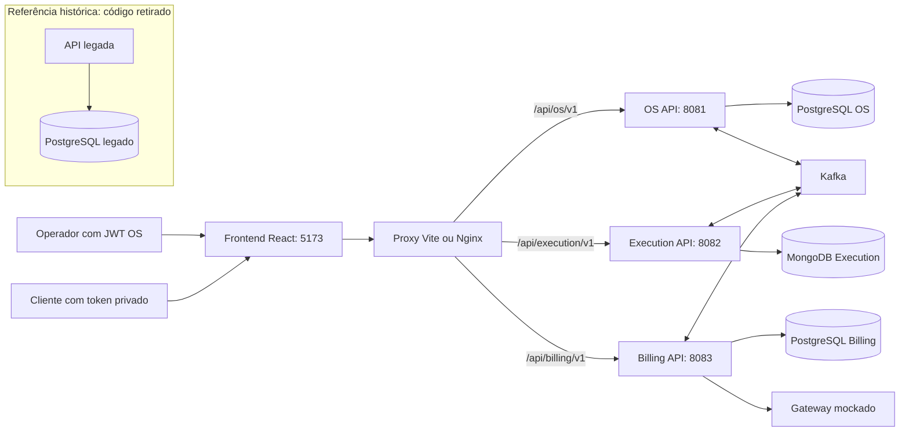
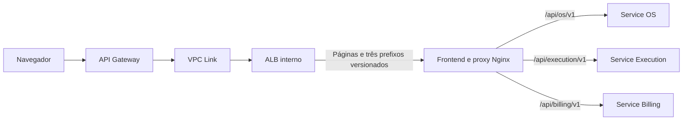
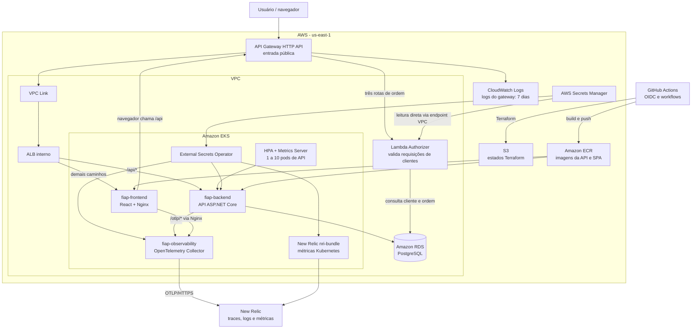
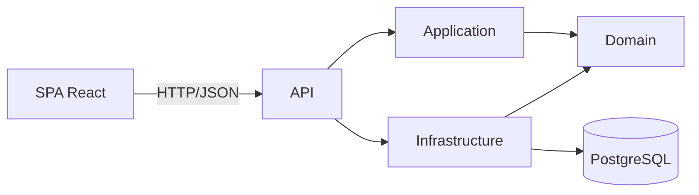

# Arquitetura da solução

Esta página distingue a aplicação integrada da infraestrutura legada existente. O código e a automação exclusiva do monólito foram [retirados do checkout](retirada-monolito.md); os diagramas legados abaixo são referências históricas, não um backend ainda fornecido. O [estado atual da migração](estado-da-migracao.md) consolida entregas, pacotes e pendências; o [guia do frontend](migracao-frontend.md) descreve a migração implementada e verificada localmente. O [primeiro incremento da Fase 4](fase4-incremento1.md) é um registro histórico da extração inicial.

O [padrão de mensageria entre serviços](mensageria.md) documenta os contratos Kafka, publicação, consumo e tratamento de falhas.
O [guia do Execution](execution.md) descreve o serviço independente com MongoDB, catálogo, estoque, execução e integração com OS.

A aplicação usa AWS, Kubernetes e PostgreSQL, com telemetria no New Relic. Esta visão descreve o código e a infraestrutura declarada; não comprova um deploy ativo. As limitações estão descritas junto de cada componente.

A [Saga de pagamento](saga-pagamento.md) descreve a coordenação OS/Billing/Execution, estados persistidos, compensação e limites de recuperação.

## Serviços extraídos e coexistência local

OS emite o JWT administrativo e valida o acesso privado do cliente; Execution e Billing validam o JWT localmente. O ciclo distribuído inclui pagamento e entrega. O frontend usa os três serviços e compõe os detalhes administrativos a partir de suas APIs. O acompanhamento usa somente o contrato público do OS, sem JWT administrativo. `docker compose up -d --build` na raiz inicia frontend, três APIs e suas dependências, preservando volumes por serviço; não implanta AWS. O ambiente local não exige Kong. Não há banco compartilhado ou coordenação síncrona HTTP entre serviços.

O authorizer Lambda abaixo pertence ao fluxo legado. Os novos endpoints de acompanhamento validam seu próprio token no OS e não consultam o banco legado. A migração do frontend foi verificada localmente; a implantação dos serviços e a troca do tráfego na AWS permanecem pendentes.

## Entrada em nuvem preparada para os microsserviços

Este é o roteamento preparado nos manifests, não evidência de implantação. O Ingress específico tem prioridade 5, anterior ao `/api` legado de prioridade 10. Os upstreams do ConfigMap devem corresponder aos Services provisionados antes do rollout. Na mesma topologia, Nginx acessa os serviços internos; apontá-lo ao gateway que retorna ao próprio Nginx criaria um ciclo. Consulte os [pré-requisitos Kubernetes](../../k8s/README.md) e a [ADR-020](../ADRs/ADR-020-frontend-microsservicos-mesma-origem.md).

## Infraestrutura legada AWS

O authorizer executa em sub-redes privadas e valida as requisições de acompanhamento, aprovação e cancelamento dos clientes. Consulta ordem e cliente ativos, confere o token de acesso e retorna `isAuthorized` ao API Gateway. Esse é o funcionamento alinhado para a Lambda; o JWT administrativo é emitido pela API.

## Entrada e isolamento

- API Gateway encaminha requisições pelo VPC Link ao listener HTTP do ALB interno.
- Os Ingresses compartilham o grupo `fiap-edge`; os services são `ClusterIP`, e o controller registra IPs dos pods nos target groups.
- O Nginx encaminha `/otlp/*` ao Collector sem autenticação específica.
- O RDS está marcado como publicamente acessível, com regras de entrada para EKS e Lambda. Os nós EKS usam sub-redes públicas; o endpoint de controle tem acesso público e privado.
- Namespaces separam a organização das cargas, sem NetworkPolicy declarada para isolamento de tráfego.

## Cargas e disponibilidade

| Carga | Configuração atual |
| --- | --- |
| Frontend | Uma réplica |
| Backend | HPA de 1 a 10 réplicas, alvo de 70% do request de CPU |
| Nós EKS | t3.small; mínimo 1, desejado 3, máximo 4; sem autoscaler de nós |
| Saúde da API | Startup/liveness em `/api/health/live`; readiness com consulta ao banco em `/api/health/ready` |
| Observabilidade | Collector e integração Kubernetes no namespace fiap-observability |

O ambiente é destruído diariamente para reduzir custos. HPA e probes não comprovam alta disponibilidade; o perfil é de laboratório, conforme a [ADR-010](../ADRs/ADR-010-ambiente-efemero-orientado-a-custo.md).

## Camadas da aplicação

O diagrama abaixo representa o backend legado. Cada serviço extraído mantém suas próprias camadas e persistência; o frontend atual acessa suas APIs pelos prefixos versionados.

Domain concentra entidades e regras; Application coordena casos de uso; API traduz HTTP e compõe dependências; Infrastructure implementa persistência e integrações. No legado, o backend é uma unidade de implantação e a Lambda tem contexto EF de leitura próprio, compartilhando o schema do banco. OS, Execution e Billing são unidades de implantação independentes, com bancos exclusivos.

## Documentos relacionados

- [Estado consolidado da migração](estado-da-migracao.md) e [guia do frontend](migracao-frontend.md).
- [Verificação local do frontend](../operacao/validacao-frontend.md).
- [Autenticação no OS](autenticacao-os.md) e [acompanhamento/entrega](acompanhamento-e-entrega.md).
- [Sequências do frontend migrado e dos fluxos legados](sequencias.md).
- [Modelo ER, relacionamentos e evolução do banco](banco-de-dados.md).
- [Observabilidade e validação](../operacao/observabilidade.md).
- [Estados e repositórios](../ADRs/ADR-008-estados-terraform-e-repositorios.md).
- [Escolhas técnicas](../RFCs/README.md) e [decisões arquiteturais](../ADRs/README.md).
