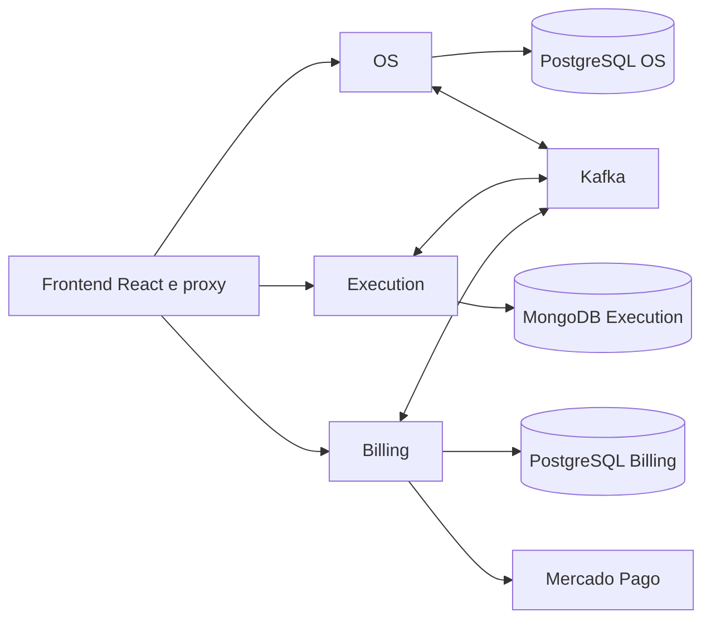
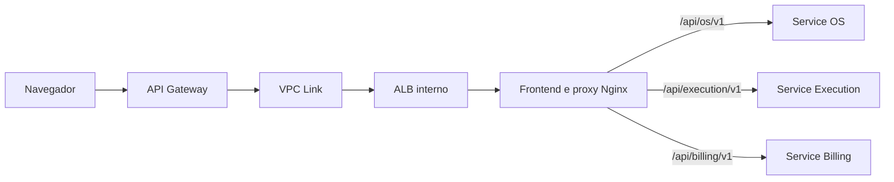
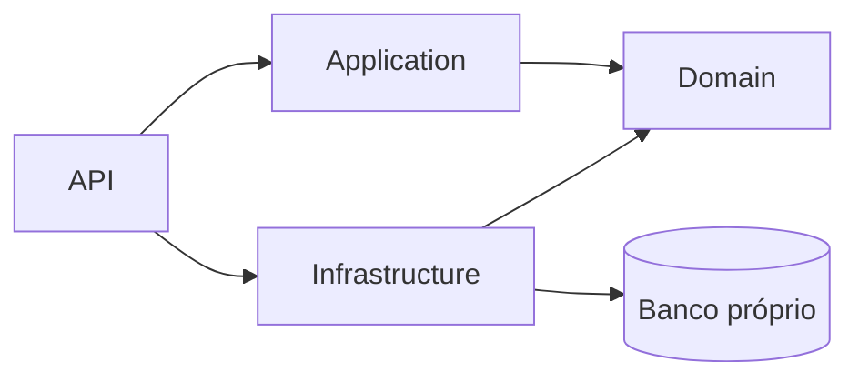

# Arquitetura dos microsserviços

OS, Execution e Billing têm domínios, bancos, builds e implantação independentes. O frontend usa as três APIs por uma mesma origem. O [estado da aplicação](estado-da-migracao.md) distingue capacidades verificadas localmente das pendências de implantação.

## Componentes e dados

OS controla cadastros, ordens, histórico, identidade administrativa e Saga. Execution controla catálogo, estoque, diagnóstico e execução. Billing controla cobrança e integração de pagamento. Cada serviço acessa apenas seu banco; Kafka transporta os contratos de eventos.

## Entrada em nuvem

O Ingress dos prefixos versionados usa prioridade 5. Os upstreams devem corresponder aos Services implantados. Nginx acessa os serviços internos; apontá-lo para um gateway que devolve a chamada ao próprio Nginx cria um ciclo. O token privado de acompanhamento é validado pelo OS; JWT administrativo é validado nas três APIs.

Infra mantém EKS, Kafka, MongoDB, entrada, namespaces, SecretStores e observabilidade. DB mantém RDS e inicialização dos bancos. Imagens ficam no ECR; GitHub Actions usa OIDC. A topologia é de laboratório, com limitações de redundância e retenção descritas no [guia AWS](../operacao/plataforma-aws.md). Manifestos não comprovam implantação ou disponibilidade remota.

## Camadas da aplicação

Domain concentra entidades e invariantes; Application coordena casos de uso; API traduz HTTP e compõe dependências; Infrastructure implementa persistência, segurança e integrações. Consumidores delegam aos casos de uso. Chassi e contratos são distribuídos por NuGet sem compartilhar entidades de negócio.

## Documentos relacionados

- [Estado da aplicação](estado-da-migracao.md) e [frontend](migracao-frontend.md).
- [Autenticação](autenticacao-os.md) e [acompanhamento e entrega](acompanhamento-e-entrega.md).
- [Sequências](sequencias.md), [dados](banco-de-dados.md) e [mensageria](mensageria.md).
- [Saga de pagamento](saga-pagamento.md) e [Execution](execution.md).
- [Kubernetes](../../k8s/README.md) e [observabilidade](../operacao/observabilidade.md).
- [RFCs](../RFCs/README.md) e [ADRs](../ADRs/README.md).

## Operação e disponibilidade

O ambiente local com frontend é iniciado no Compose da raiz do OS; os três repositórios de aplicação precisam estar lado a lado. Para valor positivo, Billing cria checkout externo e aguarda webhook válido; os testes distribuídos simulam o provedor, sem compra real.

A plataforma AWS é coordenada pelo workflow principal, com migrations por Job antes do rollout. Kafka e MongoDB usam um único membro e volume; HPAs de API não tornam essas dependências redundantes. O laboratório tem destruição diária e usa dados recriáveis. Build, dry-run e testes locais não comprovam implantação, ingestão de telemetria ou recuperação de dados remotos.
