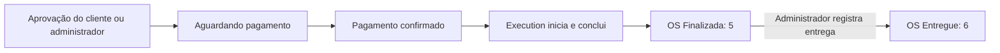

# Acompanhamento privado e entrega da ordem

O fluxo distribuído permite que o cliente consulte status, datas, total, itens do orçamento e etapa do pagamento, aprove a execução e solicite cancelamento antes da aprovação. A entrega é administrativa. O frontend foi migrado para esses contratos e verificado localmente; a aplicação não envia links automaticamente. A implantação e o roteamento AWS continuam pendentes.

## Acesso administrativo e link do cliente

Faça cadastro/login no OS para obter um JWT administrativo, conforme [autenticação no OS](autenticacao-os.md). Com esse JWT:

```http
POST /api/os/v1/ordens/{id}/acesso-cliente
Authorization: Bearer <jwt>
```

A resposta 200 contém `ordemServicoId`, `token` e `acompanhamentoUrl`, uma rota relativa da API que retorna JSON. Para acesso HTTP direto, combine-a com a origem pública da API OS. Para o cliente usar a interface, o frontend monta `{origem-do-frontend}/acompanhar-ordem/{id}?token=<token>`. A ação **Emitir/trocar link** na lista de ordens informa que o link anterior será invalidado e apresenta o novo endereço para cópia. O token só aparece na resposta de emissão, permanece válido até a próxima emissão e não é recuperável pelo banco, que guarda somente seu hash.

O acompanhamento permite aprovar/cancelar com confirmação, mostra o estado pendente após 202 e consulta novamente enquanto a página estiver visível. Não exige login administrativo. Token inválido mostra erro de acesso sem encerrar a sessão do operador que eventualmente esteja aberta no mesmo navegador.

| Operação do cliente, sem JWT | Rota |
| --- | --- |
| Consultar ordem e orçamento | `GET /api/os/v1/ordens/acompanhamento/{id}?token=<token>` |
| Aprovar orçamento | `PUT /api/os/v1/ordens/acompanhamento/{id}/aprovar-execucao?token=<token>` |
| Pedir cancelamento antes da aprovação | `PUT /api/os/v1/ordens/acompanhamento/{id}/cancelar?token=<token>` |

Token ausente, inválido, revogado ou de outra ordem retorna 401, inclusive quando a ordem não existe. Aprovar/cancelar retorna 202 após gravar a decisão e publicar no Kafka; o status operacional aguarda confirmação do Execution. A decisão repetida não republica. A decisão oposta retorna 409. Aprovação dispara pagamento no Billing e só depois libera Execution. Recusa do pagamento compensa o estoque pelo fluxo existente.

A consulta não expõe CPF, contatos, IDs de cliente/veículo ou gateway. O orçamento é uma projeção imutável do evento enviado pelo Execution. Ordens antigas podem retornar `orcamento: null` e não recebem itens inventados. Valores são decimais exatos, incluindo zero.

O link concede acesso às três operações: trate-o como uma senha. As respostas possuem `no-store` e `no-referrer`. O frontend não inicia telemetria em páginas abertas pelo link e exclui as chamadas públicas da instrumentação. Nginx omite queries dos logs e o Vite filtra tokens dos erros de proxy. Use HTTPS e mantenha o mesmo tratamento nos proxies de nuvem; a configuração remota ainda precisa ser validada. Não inclua tokens reais em evidências ou capturas de logs.

## Entrega administrativa

```http
PUT /api/os/v1/ordens/{id}/entregar
Authorization: Bearer <jwt>
```

Somente `Finalizada` (5) pode avançar para `Entregue` (6). A resposta 200 inclui a data UTC de entrega. Repetições, inclusive concorrentes, preservam essa data e um único histórico `OrdemEntregue`. Recebida, em diagnóstico, aguardando pagamento/aprovação, em execução e cancelada não podem ser entregues. Sem JWT retorna 401.



A Saga financeira permanece `Concluida` (3) após a entrega. Execution mantém sua execução `Finalizada` e Billing mantém a cobrança confirmada: entrega não gera nova cobrança, evento ou movimentação de estoque. Reentrega tardia de confirmação do Execution não regride o OS.

## Evidências

`EntregaEOrcamentoTests` cobre invariantes e snapshots. `OsMessagingTests` usa HTTP, JWT, PostgreSQL e Kafka reais para testar acesso por ordem, rotação, hash persistido, decisões, entrega concorrente e eventos tardios. `FluxoDistribuido.feature`, no Execution, inclui aprovação pelo link seguida de pagamento, execução e entrega, além de cancelamento pelo link com devolução única de estoque.

Resultados da validação desta implementação ficam em `artifacts/customer-delivery` no OS e `artifacts/customer-delivery-distributed` no Execution. Consulte também a [Saga](saga-pagamento.md), a [ADR-019](../ADRs/ADR-019-entrega-acesso-cliente.md) e a [RFC-012](../RFCs/RFC-012-entrega-acompanhamento-os.md).

Validação final: 265 testes OS sem imagem, 2 testes de imagem e 9 cenários distribuídos aprovados; cobertura de linhas OS de 90,9%. Evidências consolidadas na [validação ponta a ponta](../operacao/validacao-ponta-a-ponta.md).

A migração posterior das telas, o smoke pelas três APIs e a navegação desktop/móvel estão registrados na [verificação do frontend](../operacao/validacao-frontend.md). Esses resultados são distintos das suítes backend acima.
