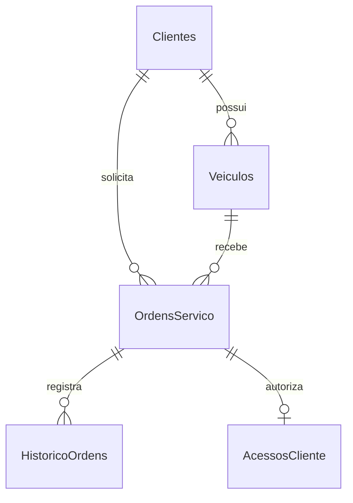

# Dados e persistência dos microsserviços

Cada serviço controla seu schema, suas migrations e suas credenciais. Não há consultas ou chaves estrangeiras entre bancos de serviços diferentes.

| Serviço | Tecnologia | Responsabilidade |
| --- | --- | --- |
| OS | PostgreSQL | Clientes, veículos, usuários, ordens, histórico, acesso privado e mensagens processadas |
| Execution | MongoDB | Catálogo, estoque, diagnóstico, orçamento e execução |
| Billing | PostgreSQL | Cobranças, dados da integração de pagamento e mensagens processadas |

Na AWS, OS e Billing usam bancos e usuários distintos no RDS. Execution usa MongoDB em replica set com TLS. As limitações de disponibilidade, backup e retenção do laboratório estão no [guia AWS](../operacao/plataforma-aws.md).

## Modelo relacional do OS

O [AppDbContext](../../src/FIAP.TechChallenge.OS.Infrastructure/Persistence/AppDbContext.cs) define os relacionamentos, constraints e filtros. O [snapshot EF](../../src/FIAP.TechChallenge.OS.Infrastructure/Persistence/Migrations/AppDbContextModelSnapshot.cs) é a referência completa dos tipos e da nulabilidade.

- Clientes possuem exclusivamente CPF ou CNPJ. Índices únicos parciais protegem documentos de registros ativos.
- Veículos referenciam clientes; placas ativas são únicas. A aplicação valida o vínculo cliente/veículo ao abrir uma ordem.
- Usuários têm login único entre ativos e senha armazenada como hash, sem vínculo obrigatório com clientes.
- Ordens preservam IDs originais, dados do orçamento e pagamento e uma versão para concorrência otimista.
- Histórico tem índice por ordem, instante e ID. Ordem e histórico são gravados em transação local.
- Acesso privado armazena somente o hash do token por ordem. Uma nova emissão substitui o acesso anterior.
- Mensagens processadas apoiam o tratamento de reentrega nos consumidores.

## Exclusão lógica e histórico

Clientes, veículos e usuários têm filtros de ativos. Inativar um cadastro não apaga a ordem nem o histórico; as consultas não exigem navegação obrigatória por um cadastro ativo. FKs de cliente, veículo e histórico restringem exclusão física. Retenção física não define política de anonimização ou reativação.

Execution preserva snapshots dos itens do orçamento. Alterações do catálogo não recalculam valores já registrados. OS não inventa orçamento ausente nem inicia pagamento sem referência e total válidos.

## Consistência e operação

Cada serviço coordena transações locais. Banco, Kafka e gateway não participam de uma transação única; entrega incerta exige reconciliação conforme a [mensageria](mensageria.md) e a [Saga](saga-pagamento.md).

Schema pertence às migrations e à configuração de cada aplicação. O [repositório DB](https://github.com/Maieru/fiap-tech-challenge-db) provisiona o RDS e inicializa bancos e credenciais. Antes de implantar, conferir migrations, conectividade, permissões e políticas de retenção. Não há migração automática de contas ou histórico entre bancos.

Novos índices exigem consulta, volume e plano de execução medidos em ambiente de teste; o modelo atual não comprova ganho de performance.

- [Dados e histórico OS](../ADRs/ADR-012-dados-historico-os.md).
- [Execution e MongoDB](../ADRs/ADR-015-execution-mongodb.md).
- [Billing e Saga](../ADRs/ADR-017-billing-saga-pagamento.md).
