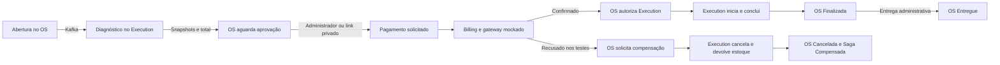

# Estado da migração para microsserviços

Atualizado em 2026-11-02. Esta página consolida o estado atual; os relatórios de incrementos anteriores preservam o contexto e os resultados da época.

OS, Execution e Billing estão implementados e integrados por Kafka, com bancos exclusivos. O fluxo de backend foi validado localmente até a entrega, com pagamento mockado e compensação por recusa. O frontend foi adaptado para os três serviços, com proxy local, contratos novos e acompanhamento privado. Build, smoke HTTP isolado e navegação local foram verificados; o tráfego AWS e a retirada do legado não foram migrados.

## Responsabilidades entregues

| Componente | Responsabilidade e dados próprios |
| --- | --- |
| OS | Clientes, veículos, abertura/consulta de ordens, histórico, usuários administrativos e emissão JWT. Coordena a Saga, projeta status e orçamento, valida acesso privado do cliente e registra entrega administrativa. PostgreSQL exclusivo. |
| Execution | Catálogo de serviços e peças/insumos, estoque, diagnóstico, snapshots do orçamento, execução, conclusão e devolução única de estoque no cancelamento. MongoDB exclusivo com transações. |
| Billing | Uma cobrança por ordem, deduplicação, resultado do gateway e consultas administrativas. PostgreSQL exclusivo. `IPaymentGateway` permite substituir o mock, que aprova imediatamente sem rede ou credenciais. |
| Contratos e chassi | Contratos por produtor em NuGet; chassi e adaptador Kafka em repositório próprio. Nenhum serviço referencia o código-fonte, domínio ou banco dos demais. |
| Frontend e legado | Permanecem no repositório principal. O frontend integra a stack dos três serviços e não depende do monólito; o backend legado continua disponível separadamente. |

O OS permanece no repositório principal, junto do legado, frontend e documentação central. Execution e Billing possuem repositórios próprios. A dependência de checkouts vizinhos no Compose serve apenas para construir as imagens locais; as bibliotecas entre serviços são consumidas por pacote versionado.

## Fluxo implementado

Aprovar/cancelar retorna 202; o OS preserva o status operacional até a confirmação do Execution. Decisão repetida não republica; decisão oposta retorna conflito. O cancelamento pelo administrador ou cliente é permitido enquanto aguarda aprovação e antes de aprovar; depois disso, apenas a compensação por recusa de pagamento pode cancelar a ordem aprovada. O histórico da aprovação é preservado.

O cliente pode consultar, aprovar e cancelar pelo link privado da ordem. Um administrador emite ou troca o token; apenas seu hash é persistido. O link vale até a próxima emissão, sem expiração automática neste incremento, e não depende de CPF nem da Lambda legada. A entrega é exclusiva do administrador após `Finalizada`: OS passa a `Entregue` (6), Execution permanece `Finalizada` (5) e a Saga continua `Concluida`. Não há nova cobrança ou evento de entrega. Consulte [acompanhamento e entrega](acompanhamento-e-entrega.md) e [Saga](saga-pagamento.md).

## Marcos e evidências

| Marco | Estado |
| --- | --- |
| Extração OS e chassi | Implementada, com soluções, testes, imagens e persistência próprias. O [primeiro incremento](fase4-incremento1.md) é histórico. |
| Execution e Kafka | Implementados, incluindo diagnóstico, orçamento, estoque e confirmação de transições. |
| Billing e Saga no OS | Implementados com gateway mockado e compensação por recusa. |
| Autenticação no OS | Implementada: cadastro anônimo por decisão do projeto, login e JWT validado localmente pelas três APIs. Não há importação de usuários legados, refresh token ou revogação de JWT já emitido. |
| Acompanhamento e entrega | Backend e frontend adaptados ao link privado e à entrega administrativa. |
| Execução local | `docker compose up -d --build` na raiz do OS inicia frontend, três APIs, dois PostgreSQL, MongoDB replica set e Kafka. Scalar/OpenAPI em cada API. |
| Validação backend | Última validação registrada: 265 testes OS sem imagem, 2 testes da imagem e 9 cenários distribuídos aprovados; cobertura OS de 90,9%. [Evidências](../operacao/validacao-ponta-a-ponta.md). |
| Migração do frontend | Implementada e verificada localmente. [Contratos, configuração e limites](migracao-frontend.md). |
| Publicação e deploy | Geração e validação locais não comprovam CI remoto, publicação de imagens, Sonar ou deploy AWS. Ver dependências abaixo. |

## Pacotes e builds reproduzíveis

Consulta ao feed público em 2026-11-02:

| Produtor | Versão necessária | Estado observado |
| --- | --- | --- |
| OS | `FIAP.TechChallenge.OS.Application.Messaging` 0.2.0, consumido pelo Billing | Disponível no [índice NuGet](https://api.nuget.org/v3-flatcontainer/fiap.techchallenge.os.application.messaging/index.json), além da versão anterior 0.1.0. Inclui `PagamentoSolicitado`. |
| Execution | `FIAP.TechChallenge.Execution.Application.Messaging` 0.1.0, consumido pelo OS | Disponível no [índice NuGet](https://api.nuget.org/v3-flatcontainer/fiap.techchallenge.execution.application.messaging/index.json). |
| Billing | `FIAP.TechChallenge.Billing.Application.Messaging` 0.1.0, consumido pelo OS | O [índice público](https://api.nuget.org/v3-flatcontainer/fiap.techchallenge.billing.application.messaging/index.json) retornou 404. Pacote candidato local disponível; publicação ainda precisa ser concluída ou confirmada. |

A ausência do OS 0.2.0 que causava `NU1102` no Billing deixou de ser a pendência observada no feed. A versão foi testada com os quatro testes de contratos e restore/build do Billing em diretório de pacotes isolado. Para o OS restaurar em um runner limpo somente pelo feed público, falta disponibilizar também os contratos Billing 0.1.0. O estado do feed pode mudar após esta consulta; confirme a versão e o resultado do workflow antes de liberar os builds consumidores.

Os candidatos locais são uma etapa explícita de desenvolvimento, sem referência entre projetos dos repositórios. Consulte [CI e dependências](../operacao/monorepo-ci.md) para restore local e publicação por produtor.

## Próximos incrementos

| Frente | Trabalho restante e critério de conclusão |
| --- | --- |
| Pacotes e CI | Publicar/confirmar Billing Messaging 0.1.0 e verificar restore limpo, build, testes, cobertura, imagem, OpenAPI e Sonar em cada repositório. |
| Frontend | Validar o frontend na borda AWS após implantar as APIs e suas dependências. A integração local, contratos e smoke HTTP estão implementados. |
| Gateway real | Implementar Mercado Pago no lugar do mock; novas tentativas após recusa, estornos e cancelamentos após aprovação ficam para incrementos posteriores. |
| Infraestrutura e tráfego | Implantar APIs, bancos, Kafka, segredos, observabilidade e roteamento. A AWS/Lambda existente ainda atende ao legado. A adaptação local do frontend não comprova migração da borda. |
| Dados | Usar bancos novos de demonstração. Não importar contas ou histórico automaticamente, reutilizar links legados ou inventar orçamento para ordens antigas. |
| Retirada do legado | Só após validar o fluxo migrado, trocar o tráfego e confirmar as dependências restantes; remover então backend, banco e artefatos exclusivos do legado. Essa retirada não foi executada. |

## Consistência e recuperação

Cada serviço mantém alterações e deduplicação na própria transação. A publicação segue **persistir → publicar e aguardar Kafka → commit local**; o consumidor confirma o offset após o commit. Falhas técnicas e contratos inválidos encerram o host e deixam o offset pendente; não há reinício automático que esconda essas falhas.

Banco, Kafka e gateway não têm atomicidade distribuída. Uma publicação entregue seguida de falha no commit pode exigir reconciliação. Não há Outbox, DLQ, retry de aplicação, framework de Saga ou timeout comercial. A compensação implementada responde à recusa de negócio; indisponibilidade técnica não é convertida em recusa. Consulte [mensageria](mensageria.md) e [Saga](saga-pagamento.md).

## Documentos relacionados

- [Roteiro da migração do frontend](migracao-frontend.md).
- [OS Service e execução local](../../src/Services/OrdensServico/README.md).
- [Execution e integração](execution.md).
- [Autenticação administrativa no OS](autenticacao-os.md).
- [Acompanhamento e entrega](acompanhamento-e-entrega.md).
- [Validação ponta a ponta](../operacao/validacao-ponta-a-ponta.md) e [validação Billing](../operacao/validacao-billing.md).
- [Arquitetura do legado/AWS](README.md) e [histórico do primeiro incremento](fase4-incremento1.md).
