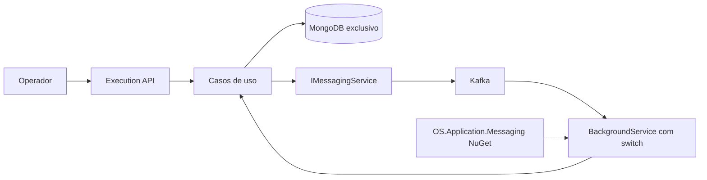

# Execution e integração com OS

O checkout FiapTechChallengeExecution é um repositório Git independente com solução .NET 10, API, Application,
Domain, Infrastructure, contratos de mensagens e testes próprios.
O Execution possui catálogo, estoque e execução. O OS publica as entradas Kafka e projeta as confirmações,
com aprovação/cancelamento administrativos ou do cliente pendentes até as confirmações. O pagamento é coordenado pelo OS com Billing antes da autorização da execução.

## Responsabilidades

| Serviço | Dados e operações |
| --- | --- |
| OS | Clientes, veículos, usuários/JWT, abertura/consulta, decisão administrativa ou do cliente, Saga, projeção Kafka e entrega |
| Billing | Cobrança por ordem com gateway mockado e eventos de confirmação/recusa |
| Execution | Catálogo de serviços e peças/insumos, estoque, diagnóstico, snapshots e execução |
| Legado | Continua funcionando com banco, frontend e rotas existentes |

Não há referências ao código-fonte nem acesso ao banco do OS/legado.
Cliente e veículo são somente identificadores recebidos na mensagem de abertura.
O agregado novo usa as regras e snapshots de itens extraídos do legado; catálogo e testes foram reaproveitados com namespaces próprios.

## Fluxo implementado

1. OrdemServicoCriada registra uma execução Recebida e a deduplicação na mesma transação.
2. O operador inicia diagnóstico pela API; Execution publica DiagnosticoIniciado.
3. O operador adiciona serviços e peças do catálogo. A inclusão da peça e sua baixa de estoque são atômicas.
4. Solicitar aprovação encerra o diagnóstico e publica DiagnosticoConcluido, com snapshots e valores.
5. A aprovação no OS solicita pagamento ao Billing. Somente PagamentoConfirmado faz OS publicar ExecucaoAutorizada, que inicia a execução e publica ExecucaoIniciada.
6. Cada serviço concluído exige tempo positivo. Finalizar exige todos os serviços concluídos e publica ExecucaoConcluida.
7. CancelamentoSolicitado só é aceito enquanto a execução aguarda aprovação. Abrange a decisão anterior à aprovação no OS e a compensação por recusa de pagamento; nesse segundo caso, Execution ainda não foi autorizado. A devolução de estoque e a mudança para Cancelada são gravadas juntas, com publicação de ExecucaoCancelada.
8. Após a conclusão, OS pode registrar entrega administrativa. Execution permanece Finalizada; entrega não gera novo contrato Kafka nem movimento de estoque.

Mensagens repetidas não repetem efeitos já confirmados. Um cancelamento repetido com novo MessageId também não devolve estoque novamente.
Peças inativadas permanecem disponíveis para devolução interna, preservando sua inativação.

A sequência transacional é a do [padrão](mensageria.md). A mensagem pode existir no Kafka mesmo se o commit posterior falhar;
um teste reproduz essa condição com falha injetada exclusivamente na unidade de trabalho do teste, usando banco e Kafka reais.

## API e operação

Prefixo /api/execution/v1. Catálogos têm CRUD e soft delete; peças têm entrada de estoque e serviços têm consulta de tempo médio.
As ordens têm listagem, consulta, início de diagnóstico, inclusão de itens, solicitação de aprovação,
conclusão de serviço e finalização. Não há endpoint de abertura ou autorização de execução: essas entradas vêm do Kafka.

A API valida JWT real e usa o chassi para erros técnicos, correlação, logs e health checks.
Erros de negócio preservam error/errorCode. Duplicidade e concorrência retornam 409.
Paginação começa em 1/10 e limita PageSize a 100.

O Compose local publica API em 8082, MongoDB em 27018 e Kafka em 19093, somente em loopback.
MongoDB e Kafka têm volumes exclusivos; consumidores não reiniciam automaticamente após erro.
Consulte o [README do Execution](https://github.com/Maieru/fiap-tech-challenge-execution#readme) para comandos e variáveis. Execution continua consumindo OS Messaging 0.1.0; o contrato Execution 0.1.0 também está publicado. OS Messaging 0.2.0 acrescenta o pedido de pagamento consumido pelo Billing, preservando os tipos usados pelo Execution. Ver [pacotes e pendências de publicação](estado-da-migracao.md#pacotes-e-builds-reproduzíveis).

## Verificação e limites

Há testes de domínio, aplicação, contratos, integração HTTP/MongoDB/Kafka e da imagem.
O teste da imagem verifica JWT, OpenAPI e permanência do catálogo após reiniciar o container.

Os testes não usam volumes de desenvolvimento, autenticação substituta ou mocks nos endpoints HTTP.
Os nove cenários distribuídos registrados com as três APIs reais estão em Distributed.slnx no Execution, separados da solução padrão.
O workflow distribuído é manual e recebe imagens publicadas; não faz parte da execução automática de toda validação isolada.
O [histórico de validação](../operacao/validacao-execution.md) preserva as evidências de cada entrega.
Billing com mock e Saga no OS estão implementados. O frontend foi adaptado aos três serviços e verificado localmente, incluindo catálogo/estoque e operações do Execution. O código do monólito já foi retirado. Gateway de pagamento real, deploy dos novos serviços e retirada operacional dos recursos/dados legados permanecem pendentes, conforme o [estado da migração](estado-da-migracao.md). O [guia do frontend](migracao-frontend.md) descreve contratos, proxies e limites; a [verificação local](../operacao/validacao-frontend.md) registra os resultados.

Decisões: [ADR-015](../ADRs/ADR-015-execution-mongodb.md), [RFC-008](../RFCs/RFC-008-execution-mongodb-kafka.md),
[ADR-016](../ADRs/ADR-016-integracao-os-execution.md) e [RFC-009](../RFCs/RFC-009-integracao-os-execution.md).
