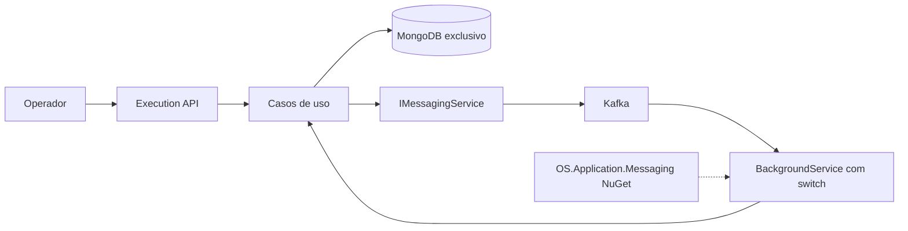

# Execution — etapa 2

O checkout FiapTechChallengeExecution é um repositório Git independente com solução .NET 10, API, Application,
Domain, Infrastructure, contratos de mensagens e testes próprios.
Esta etapa entrega o serviço Execution. O OS continua com seu comportamento anterior;
a integração completa entre as duas aplicações será a etapa 3.

## Responsabilidades

| Serviço | Dados e operações |
| --- | --- |
| OS | Clientes, veículos e abertura/consulta de ordens; aprovação administrativa e projeção Kafka ainda pendentes |
| Execution | Catálogo de serviços e peças/insumos, estoque, diagnóstico, snapshots e execução |
| Legado | Continua funcionando com banco, frontend e rotas existentes |

Não há referências ao código-fonte nem acesso ao banco do OS/legado.
Cliente e veículo são somente identificadores recebidos na mensagem de abertura.
O agregado novo usa as regras e snapshots de itens extraídos do legado; catálogo e testes foram reaproveitados com namespaces próprios.

## Fluxo implementado

1. OrdemServicoCriada registra uma execução Recebida e a deduplicação na mesma transação.
2. O operador inicia diagnóstico pela API; Execution publica DiagnosticoIniciado.
3. O operador adiciona serviços e peças do catálogo. A inclusão da peça e sua baixa de estoque são atômicas.
4. Solicitar aprovação encerra o diagnóstico e publica DiagnosticoConcluido, com snapshots e valores.
5. ExecucaoAutorizada inicia a execução e publica ExecucaoIniciada.
6. Cada serviço concluído exige tempo positivo. Finalizar exige todos os serviços concluídos e publica ExecucaoConcluida.
7. CancelamentoSolicitado só é aceito enquanto aguarda aprovação. A devolução de estoque e a mudança para Cancelada
   são gravadas juntas, com publicação de ExecucaoCancelada.

Mensagens repetidas não repetem efeitos já confirmados. Um cancelamento repetido com novo MessageId também não devolve estoque novamente.
Peças inativadas permanecem disponíveis para devolução interna, preservando sua inativação.

A sequência transacional é a do [padrão](mensageria.md). A mensagem pode existir no Kafka mesmo se o commit posterior falhar;
um teste reproduz essa condição com falha injetada exclusivamente na unidade de trabalho do teste, usando banco e Kafka reais.

## API e operação

Prefixo /api/execution/v1. Catálogos têm CRUD e soft delete; peças têm entrada de estoque e serviços têm consulta de tempo médio.
As ordens têm listagem, consulta, início de diagnóstico, inclusão de itens, solicitação de aprovação,
conclusão de serviço e finalização. Não há endpoint de abertura ou autorização de execução: essas entradas vêm do Kafka.

A API valida JWT real e usa o chassi para erros técnicos, correlação, logs e health checks.
Erros de negócio preservam error/errorCode. Duplicidade e concorrência retornam 409.
Paginação começa em 1/10 e limita PageSize a 100.

O Compose local publica API em 8082, MongoDB em 27018 e Kafka em 19093, somente em loopback.
MongoDB e Kafka têm volumes exclusivos; consumidores não reiniciam automaticamente após erro.
Consulte o README do checkout Execution para comandos, variáveis e roteiro de restauração do contrato OS ainda não publicado.

## Verificação e limites

A verificação local cobriu 149 testes do Execution: 81 de domínio, 44 de aplicação, 6 de contratos,
17 de integração HTTP/MongoDB/Kafka e 1 da imagem. A cobertura consolidada final foi de 93,8% das linhas.
O teste da imagem verifica JWT, OpenAPI e permanência do catálogo após reiniciar o container.

Os testes não usam volumes de desenvolvimento, autenticação substituta ou mocks nos endpoints HTTP.
O cenário distribuído com as duas APIs reais e BDD será acrescentado na etapa 3.
Não há Billing, pagamentos, AWS, migração de dados/frontend nem deploy Kubernetes neste incremento.

Decisões: [ADR-015](../ADRs/ADR-015-execution-mongodb.md) e [RFC-008](../RFCs/RFC-008-execution-mongodb-kafka.md).
