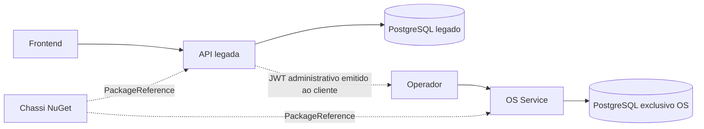
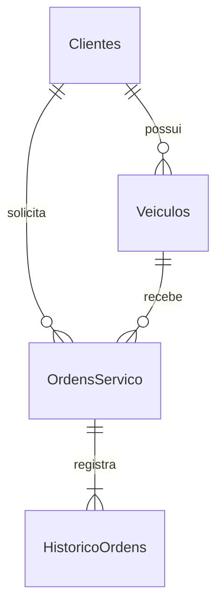
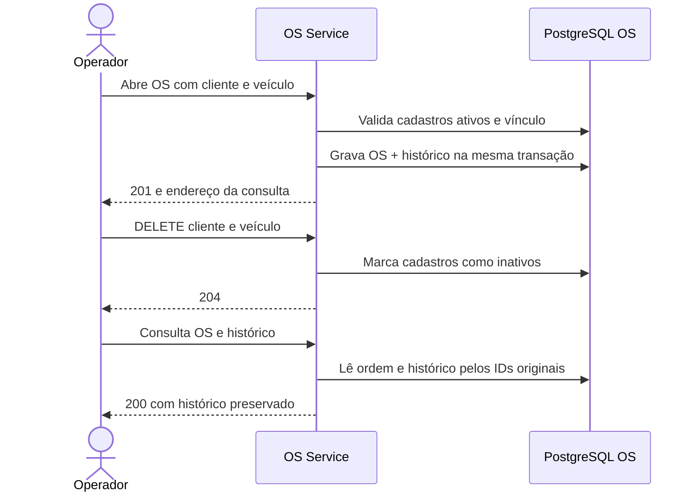

# Fase 4 — primeiro incremento

> Registro histórico da extração inicial. As entregas e pendências abaixo descrevem aquele momento. Para a situação atual, consulte o [estado da migração](estado-da-migracao.md).

O repositório hospeda o monólito existente e o OS Service. O [chassi técnico](https://github.com/Maieru/fiap-tech-challenge-chassis) possui repositório e publicação próprios e é consumido por versão NuGet explícita. O serviço novo possui build, testes, imagem, credenciais e PostgreSQL próprios. A coexistência é local; nenhum tráfego do frontend ou da AWS foi migrado.

O OS valida o JWT sem chamar o monólito. Não existem referências de projeto do OS para o legado, acesso cruzado a bancos nem entidades de negócio no NuGet. Infra e autenticação serverless continuam em seus repositórios existentes.

## Reaproveitamento

| Componente | Tratamento |
| --- | --- |
| Cliente, Veiculo, CPF/CNPJ, placa, email e telefone | Extraídos com as validações existentes |
| Result, Error e enums pertinentes | Extraídos para o domínio do OS; não publicados como negócio compartilhado |
| Casos de uso de clientes e veículos | Extraídos; duplicidades classificadas como Conflict no OS |
| Commands e responses de cadastros | Reaproveitados, inclusive campos imutáveis e filtros |
| Abertura da OS | Extraída; removidos token de aprovação e dependência da métrica legada |
| Agregado de OS | Adaptado para invariantes de abertura; demais transições permanecem no legado |
| Listagem de OS | Reaproveitados contrato, filtros e validações de paginação |
| Consulta de OS | Adaptada para dados próprios, sem exigir cliente ativo ou itens de Billing/Execution |
| Repositórios de cadastros e mappers | Extraídos; updates preservam Ativo e usam controle de concorrência |
| Contexto, migration e histórico | Novos e exclusivos do OS |
| Controllers de cadastros | Extraídos com prefixo próprio e Location apontando à consulta |
| Testes de domínio/aplicação | Extraídos e complementados para a abertura |
| Testes HTTP legados em PostgreSQL | Mesmos arquivos-fonte compilados em outra suíte, sem copiar os cenários |

A tabela acima concentra o inventário de responsabilidades reaproveitadas; o CSV arquivo a arquivo foi removido na organização do repositório. A duplicação transitória entre legado e OS é intencional: cada serviço evolui por sua responsabilidade. Antes de desativar o fluxo antigo, confrontar regras e cenários alterados durante a coexistência.

## Dados e histórico

`Clientes` e `Veiculos` têm filtros de ativos e índices únicos parciais para documentos/placas normalizados. FKs usam restrição à exclusão física. Documento do cliente deve ser CPF ou CNPJ, exclusivamente. A ordem tem descrição validada, status inicial Recebida e índice de data/ID; o histórico tem índice por ordem/data/ID.

Uma única chamada relacional a SaveChanges grava ordem e histórico na mesma transação. O teste de rollback adiciona uma constraint temporária somente no banco de testes para forçar a falha do histórico; não existem endpoints ou flags de falha em produção.

DELETE não remove linhas nem propaga inativação. Clientes/veículos inativos não podem participar de novas ordens. As consultas da ordem e do histórico leem somente seus próprios registros e IDs: ocultar um cadastro não oculta a ordem. Isso resolve no novo serviço a limitação descrita na ADR-004 do legado, sem acrescentar snapshots de dados pessoais ou reativação.

## Limites de conformidade

Este incremento não conclui a Fase 4: continuam pendentes três serviços em repositórios independentes, SQL/NoSQL, comunicação assíncrona, Saga/compensações, Mercado Pago, BDD distribuído e deploy Kubernetes. O chassi contém somente um envelope genérico; isso não constitui implementação de mensageria. O BDD atual cobre o monólito e o primeiro fluxo do OS, não uma transação distribuída.
