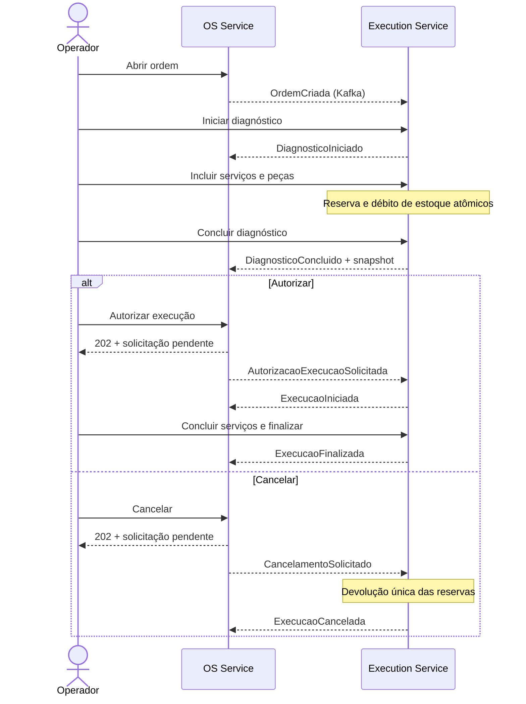

# Fase 4 — Execution e integração com OS

O [Execution Service](https://github.com/Maieru/fiap-tech-challenge-execution) é independente, com catálogo, diagnóstico, estoque/reservas e execução em MongoDB replica set. O OS mantém clientes/veículos, estado geral e histórico no PostgreSQL existente. O monólito continua disponível e não participa do novo fluxo.

Todos os eventos via Kafka, com chave OrdemServicoId, Outbox/Inbox e sequência por direção. Gravações locais são transacionais; falhas técnicas seguem retries e DLQ, recusas de negócio geram SolicitacaoRecusada. A consulta mostra ação pendente até confirmação/recusa. A autorização temporária registra operador/origem e requer flag explícita em Development/Testing; não representa pagamento nem aprovação do cliente.

## Adaptações no OS

| Componente | Tratamento |
| --- | --- |
| Cliente, veículo, validações e casos de uso | Mantidos |
| Abertura da ordem | Adaptada para gravar OrdemCriada na mesma transação da ordem/histórico |
| OrdemServico e reidratação | Adaptadas para estados, datas e ação pendente reais; versão e sequências permanecem na persistência |
| Histórico | Adaptado com detalhes JSON de solicitação, operador e eventos |
| Repositórios e AppDbContext | Adaptados para concorrência, Outbox/Inbox e aplicação transacional |
| SolicitarFluxo e endpoints administrativos | Novos, HTTP 202 e confirmação assíncrona |
| Migration/backfill | Novos, aditivos; preservam cadastros, histórico, IDs e volume |
| KafkaWorker | Novo por serviço, sem referência de projeto ou pacote de negócio compartilhado |
| Testes | Mantidos e ampliados com upgrade do esquema, Kafka, rollback, concorrência e auditoria |

O [README do OS](../../src/Services/OrdensServico/README.md) documenta o overlay de execução. Contratos, retry/DLQ/replay, BDD e configuração do novo Sonar estão na [operação do Execution](https://github.com/Maieru/fiap-tech-challenge-execution/blob/main/docs/operacao.md). A [ADR-014](../ADRs/ADR-014-execution-kafka-consistencia.md) e a [RFC-007](../RFCs/RFC-007-outbox-inbox-e-autorizacao-os.md) registram as decisões.

## Responsabilidades no código

| Classe | Responsabilidade |
| --- | --- |
| OrdemServico | Validar a evolução do estado e a solicitação pendente. Não conhece Kafka, offsets, sequência de mensagens ou versão do banco. |
| FluxoOrdemRepository | Salvar solicitação/evento, ordem, histórico e Inbox/Outbox na mesma transação PostgreSQL. Verifica sequência e concorrência na persistência. |
| PostgresOutbox | Consultar mensagens pendentes, controlar um publicador ativo e marcar mensagens confirmadas. Não altera ordens. |
| KafkaWorker | Publicar/consumir no broker, confirmar offsets, repetir falhas e encaminhar à DLQ. Não decide transições de negócio. |

Exemplo: abrir uma ordem grava a OS e sua mensagem pendente juntas. Se Kafka estiver fora do ar, a ordem continua salva e a mensagem aguarda na Outbox. Quando o broker voltar, o worker a publica. A Inbox registra mensagens já processadas para que uma reentrega não repita a mudança da ordem. Esses registros ficam no banco de cada serviço; não são outros microsserviços.

AWS, Billing, aprovação pelo cliente, frontend e migração de tráfego/dados permanecem fora do incremento. OS continua temporariamente no monorepo; Execution e chassi já possuem repositórios próprios.
