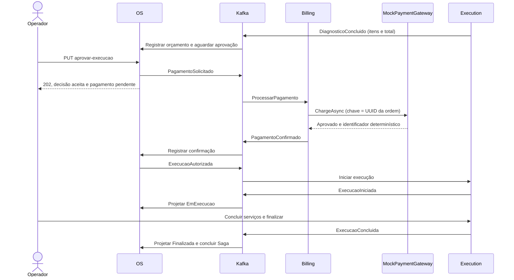
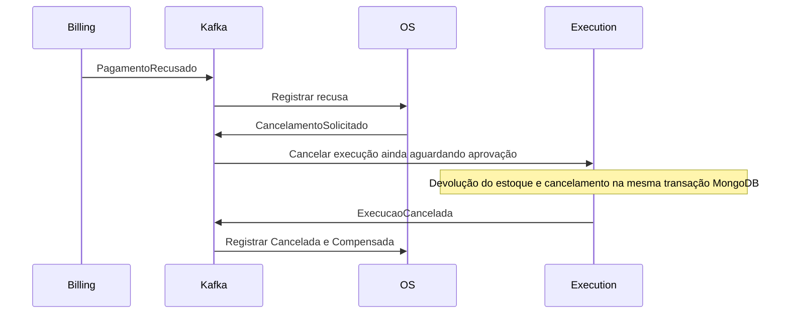

# Saga de pagamento entre OS, Billing e Execution

Este guia descreve a implementação atual da Saga e seu limite de compensação. OS coordena o processo; Billing realiza a cobrança; Execution controla o trabalho e o estoque. As decisões estão na [ADR-017](../ADRs/ADR-017-billing-saga-pagamento.md) e na [RFC-010](../RFCs/RFC-010-billing-mock-kafka.md).

## Responsabilidades e persistência

| Serviço | Responsabilidade | Persistência própria |
| --- | --- | --- |
| OS | Decisão administrativa ou do cliente, orçamento projetado, etapa da Saga, projeção da execução e entrega | PostgreSQL; `OrcamentoId`, `ValorOrcamento`, `OrcamentoJson`, `PagamentoJson` e `DataEntrega` na ordem, acessos privados, histórico e mensagens processadas |
| Billing | Uma cobrança por ordem e interação com o gateway | PostgreSQL; cobrança, resultado, identificador externo, datas e mensagens processadas |
| Execution | Diagnóstico, snapshots dos itens, baixa/devolução de estoque e execução | MongoDB; execução, itens e estoque |

Não há banco compartilhado nem chamadas HTTP entre os serviços para coordenar a Saga. O estado da Saga acompanha a linha da ordem no OS, sob a mesma transação e controle de concorrência. Não há motor ou framework de Saga.

## Fluxo aprovado

1. Execution encerra o diagnóstico e publica os snapshots e `ValorTotal`. OS guarda o total e usa o `MessageId` original desse evento como `OrcamentoId`. Itens e preços detalhados continuam pertencendo ao Execution; o OS mantém uma projeção imutável dos snapshots para o acompanhamento privado do cliente.
2. A aprovação administrativa registra `Decisao = Autorizada`, cria `Pagamento` em `AguardandoPagamento` e grava histórico `PagamentoSolicitado`. Publica o pedido de pagamento e retorna 202 após o commit local. Essa resposta não comprova pagamento nem início de execução.
3. Billing abre transação, verifica deduplicação e adquire um advisory lock PostgreSQL pela ordem. Uma solicitação já concluída com os mesmos dados não chama novamente o gateway nem republica resultado. Dados diferentes para a mesma ordem são recusados.
4. Na primeira solicitação, Billing cria a cobrança em memória e chama `IPaymentGateway.ChargeAsync`. O mock aprova imediatamente e devolve `mock-<UUID da ordem>`. Valor zero é permitido; o valor decimal recebido é preservado, sem recalcular ou arredondar os itens.
5. Billing grava cobrança e deduplicação, publica o resultado e confirma a transação. O consumidor confirma o offset depois desse commit.
6. OS valida orçamento, cobrança, valor e moeda do resultado contra o pedido persistido. Na confirmação, registra o resultado e publica `ExecucaoAutorizada`. Apenas esse evento libera o início no Execution.
7. As confirmações do Execution fazem OS avançar para execução e conclusão. Não existe endpoint Billing de criação manual de cobrança: sua API é de consulta com JWT administrativo.

A aprovação repetida mantém a decisão existente e não publica outro pedido. O cancelamento administrativo depois da aprovação continua retornando conflito, inclusive enquanto aguarda pagamento.

## Etapas observáveis no OS

| `Pagamento.Etapa` | Valor JSON | Quando ocorre | Status operacional esperado |
| --- | --- | --- | --- |
| `AguardandoPagamento` | 0 | Aprovação administrativa e pedido publicados | `AguardandoAprovacao` |
| `AutorizacaoSolicitada` | 1 | Pagamento confirmado; autorização publicada | `AguardandoAprovacao` |
| `ExecucaoIniciada` | 2 | Confirmação do início pelo Execution | `EmExecucao` |
| `Concluida` | 3 | Confirmação da conclusão pelo Execution; permanece após entrega administrativa | `Finalizada` ou `Entregue` |
| `CompensacaoSolicitada` | 4 | Pagamento recusado; cancelamento publicado | `AguardandoAprovacao` |
| `Compensada` | 5 | Cancelamento confirmado pelo Execution | `Cancelada` |

Antes da aprovação, `Pagamento` é nulo. `OrcamentoId` e `ValorOrcamento` podem existir desde o diagnóstico. Os estados operacionais não mudam apenas porque um comando foi enviado: o OS espera as confirmações. O campo `Pendente` da resposta administrativa permanece verdadeiro enquanto o status operacional for `AguardandoAprovacao`; consulte também `Pagamento.Etapa` para distinguir o motivo da espera.

`Pagamento` guarda referência do orçamento, valor, moeda, etapa e, quando recebidos, `CobrancaId`, `GatewayPaymentId` ou `Motivo`. A cobrança no Billing tem situação própria: `Pendente=0`, `Confirmada=1`, `Recusada=2`. Esses valores não são o enum de etapas da Saga.

## Compensação por recusa

A recusa é um resultado de negócio, não uma exceção técnica. OS mantém a decisão administrativa `Autorizada` e o histórico da aprovação, registra o motivo da recusa e solicita o cancelamento. A regra de projeção permite cancelar essa ordem aprovada especificamente pela compensação pendente.

Execution usa seu cancelamento existente: devolve cada peça, inclusive se ela foi inativada no catálogo, e grava o cancelamento na mesma transação. Uma execução já cancelada não devolve estoque novamente, mesmo com outro `MessageId`. OS só marca a compensação como concluída ao receber `ExecucaoCancelada`.

O mock de produção sempre aprova. A recusa é exercitada por implementação substituta de `IPaymentGateway` nos testes Billing. No BDD distribuído, um responder Kafka de teste assume a resposta recusada enquanto Billing real está parado; isso valida a integração de compensação OS/Execution, sem representar uma recusa do mock de produção.

O cancelamento administrativo anterior à aprovação é outro caminho: não cria pagamento nem cobrança e utiliza o mesmo cancelamento do Execution. Não é uma Saga de pagamento compensada.

## Contratos e identificação

| Produtor | Mensagem | Tópico |
| --- | --- | --- |
| Execution | `execution.diagnostico-concluido` | `oficina.execution.events.v1` |
| OS | `os.pagamento-solicitado` | `oficina.os.billing.requests.v1` |
| Billing | `billing.pagamento-confirmado` ou `billing.pagamento-recusado` | `oficina.billing.events.v1` |
| OS | `os.execucao-autorizada` ou `os.cancelamento-solicitado` | `oficina.os.events.v1` |
| Execution | `execution.execucao-iniciada`, `execution.execucao-concluida` ou `execution.execucao-cancelada` | `oficina.execution.events.v1` |

- Envelope versão 1; chave Kafka = `OrdemServicoId.ToString("D")`.
- `MessageId` identifica a entrega lógica e é preservado no reenvio técnico. `OrcamentoId` identifica o diagnóstico original; `CobrancaId` identifica o registro Billing. A chave de idempotência do gateway é a ordem, não um novo UUID por tentativa técnica.
- `CorrelationId` percorre a cadeia; `CausationId` aponta para a mensagem que causou a emissão. Contexto W3C e instantes UTC acompanham as mensagens.
- Grupos padrão: `oficina-os-v1`, `oficina-billing-v1` e `oficina-execution-v1`. Réplicas do mesmo serviço compartilham o grupo; testes usam grupos e recursos isolados.
- OS consome Execution e Billing. Billing consome apenas o tópico dedicado de pedidos. Execution continua consumindo os contratos OS já existentes.

## Garantias locais e limites distribuídos

Cada serviço aplica alterações e deduplicação na própria transação. OS usa `FOR UPDATE` e versão da linha; Billing usa lock por ordem e índice único para impedir cobranças concorrentes. O processamento também verifica o estado de negócio para não repetir efeitos com outro identificador de mensagem.

A ordem geral é **gravar localmente → publicar e aguardar Kafka → commit local → confirmar offset**. A chamada ao gateway no Billing ocorre antes da gravação e publicação finais, dentro do período da transação. Não há transação distribuída entre gateway, banco e Kafka.

| Falha | Comportamento implementado |
| --- | --- |
| Billing parado | Pedido permanece no Kafka; OS aguarda pagamento e não autoriza Execution |
| Exceção no gateway | Não produz recusa de negócio; transação é desfeita e consumidor encerra com offset pendente |
| Erro de publicação | Tenta-se desfazer a transação; entrega pode ser incerta em timeout |
| Publicação entregue e commit posterior falha | Evento pode ser órfão e já ter provocado efeitos em outro serviço; exige reconciliação |
| Commit local bem-sucedido, mas offset não confirmado | Reentrega é deduplicada pelo registro local e pelo estado de negócio |
| Mensagem inválida ou estado conflitante | Host encerra com código não zero, sem avançar o offset da mensagem; o grupo pode ficar bloqueado |

Não há Outbox, DLQ, retry de aplicação, timeout comercial da Saga, cancelamento automático por indisponibilidade ou estorno. Uma falha técnica após pagamento confirmado não aciona por si só a compensação por recusa. O mock não realiza um débito externo, mas um gateway real deverá respeitar a chave de idempotência e tratar resultados incertos.

Os consumidores exigem a presença de `valorTotal` no diagnóstico e de `valor` nos pedidos e resultados de pagamento, como número JSON decimal válido. Ausência, null, string e overflow interrompem o consumo sem avançar o offset; zero explícito continua permitido. A [revisão da implementação](../operacao/revisao-billing-saga.md) registra os achados originais e as correções aplicadas, incluindo a espera por offsets nos testes de reentrega.

## Diagnóstico e retomada

1. Consultar a ordem no OS, a cobrança no Billing e a execução no Execution pelas APIs autenticadas. Comparar ordem, orçamento, cobrança, valor e etapa.
2. Localizar logs por correlação e `MessageId`; registrar grupo, tópico, partição, offset e erro. Readiness verifica dependências, mas não comprova que uma Saga específica terminou.
3. Em entrega incerta, comparar estados confirmados e mensagens Kafka antes de reenviar. Um evento órfão não pode ser tratado como uma transação automaticamente desfeita em todos os serviços.
4. Corrigir a causa e reiniciar o consumidor no mesmo grupo. Reenvio técnico deve preservar envelope e chave originais. Não avançar offsets ou devolver estoque manualmente sem uma reconciliação explícita.

Os novos serviços podem usar dados novos de demonstração. Ordens antigas sem referência e total de orçamento não iniciam pagamento automaticamente. Não existe cobrança retroativa ou importação do histórico legado neste incremento.

## Código e verificações

- Coordenação: `OrdemServico`, `PagamentoOrdem`, `AutorizarExecucaoUseCase`, `RegistrarPagamentoUseCase` e os casos de projeção do Execution no OS.
- Cobrança: `ProcessarPagamentoUseCase`, `BillingDbContext`, `IPaymentGateway` e `MockPaymentGateway` no Billing.
- Compensação de estoque: `CancelarExecucaoUseCase` no Execution.
- Consulte o [padrão de mensageria](mensageria.md), o [estado da migração](estado-da-migracao.md) e as [evidências Billing](../operacao/validacao-billing.md). Os testes isolados e distribuídos verificam caminhos de negócio e falhas específicas; não oferecem garantia de exactly-once entre serviços.

## Cliente e entrega

A aprovação também pode ocorrer por [link privado do cliente](acompanhamento-e-entrega.md), com os mesmos casos de uso e invariantes. O cancelamento pelo link só é aceito antes da aprovação. Após a execução concluir, um administrador pode marcar a ordem `Entregue` no OS. A etapa financeira continua `Concluida`; Execution permanece `Finalizada`. Entrega não publica evento nem movimenta cobrança/estoque.
