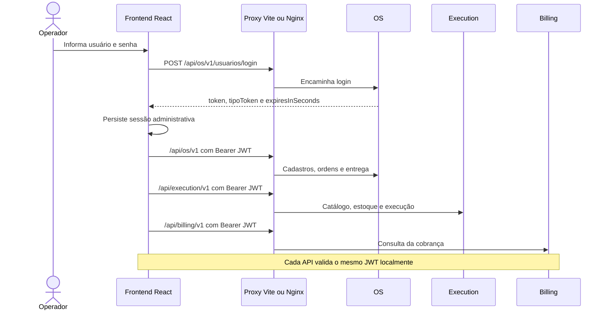
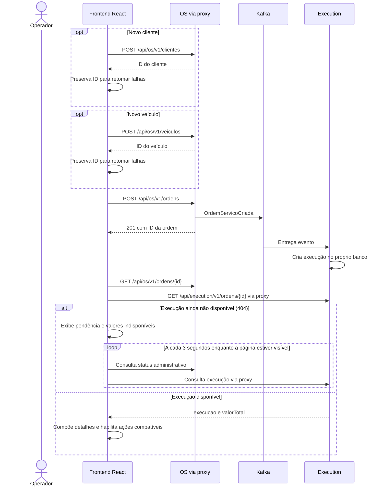

# Sequências dos fluxos principais

Os diagramas descrevem o frontend e os microsserviços verificados localmente. O [estado da migração](estado-da-migracao.md) distingue essa validação da implantação AWS ainda pendente.

## Frontend migrado: autenticação e roteamento

Localmente, o proxy evita acesso do navegador às três portas e não exige Kong. Na configuração de nuvem preparada, API Gateway e ALB ficam antes do Nginx, preservando os prefixos. Essa topologia ainda requer implantação e validação remotas.

## Frontend migrado: abertura e confirmação assíncrona

As etapas de cadastro não formam uma transação única. IDs confirmados são reutilizados após erro; timeout após commit ainda exige conferir o cadastro por não haver chave de idempotência. Aprovação/cancelamento retornam 202 e aguardam confirmação por eventos. O acompanhamento usa somente o contrato público do OS e token privado, sem JWT administrativo. Ver [acompanhamento e entrega](acompanhamento-e-entrega.md), [Saga](saga-pagamento.md) e [verificação do frontend](../operacao/validacao-frontend.md).
