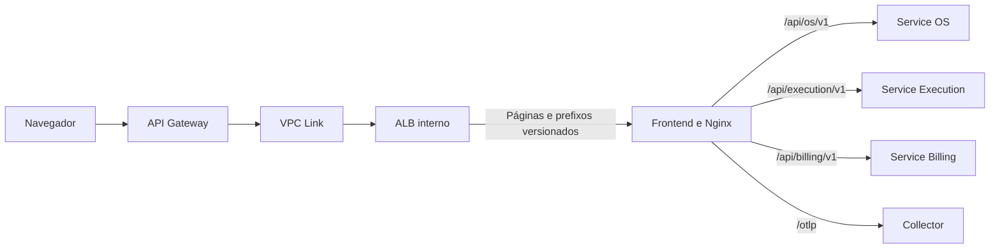

# Kubernetes — OS, frontend e integração dos microsserviços

Esta árvore ativa contém os manifests de OS e do frontend migrado. Execution e Billing mantêm seus manifests em seus próprios repositórios. Namespaces, SecretStores, add-ons, observabilidade e infraestrutura compartilhada pertencem ao repositório Infra. Esta configuração prepara o EKS; não comprova implantação na nuvem.

## Pré-requisito do frontend migrado

Antes do rollout, disponibilize OS, Execution e Billing com seus bancos/Kafka/segredos e ajuste os upstreams do ConfigMap aos Services reais. Os nomes padrão são:

| Variável | Destino esperado |
| --- | --- |
| `OS_UPSTREAM` | `http://fiap-os-service.fiap-os.svc:8080` |
| `EXECUTION_UPSTREAM` | `http://fiap-execution-service.fiap-execution.svc:8080` |
| `BILLING_UPSTREAM` | `http://fiap-billing-service.fiap-billing.svc:8080` |

Os Services das APIs são definidos nos manifestos de cada serviço, não na pasta `frontend`. A imagem frontend não usa o backend antigo. Não configure Nginx para chamar o próprio gateway que devolve a requisição ao mesmo Nginx, pois isso cria um ciclo.

A entrada pública usa HTTPS no API Gateway. Os trechos internos usam HTTP por decisão do laboratório ([ADR-022](../docs/ADRs/ADR-022-kubernetes-microsservicos.md)); rede privada não fornece criptografia. O Collector recebe OTLP/HTTP do frontend em `http://otel-collector.fiap-observability.svc:4318` e OTLP gRPC das APIs em 4317; somente a saída ao New Relic exige TLS neste fluxo.

O frontend não exige mais o Secret `fiap-upstream-ca`. `UPSTREAM_CA_CERTIFICATE` usa o bundle do sistema. O Nginx preserva validação de cadeia e hostname caso se configure um upstream HTTPS futuro; nesse caso, certificados/SAN e eventual bundle de CA privada devem ser fornecidos antes do rollout. O Compose local continua usando HTTP.

## Topologia preparada



Os Ingresses compartilham `fiap-edge`. `microservices-ingress.yaml` tem prioridade 5 para os três prefixos, anterior à regra `/api` legada de prioridade 10 caso ainda exista no cluster. O Ingress de páginas tem prioridade 20. A regra legada existente só deve ser retirada junto da migração de tráfego; excluir um arquivo local não a remove do cluster.

Esta topologia é configuração versionada, não evidência de deploy. API Gateway deve preservar os caminhos e encaminhar acompanhamento/decisões novos para validação do token privado no OS, sem o authorizer legado por CPF. Queries não devem aparecer em logs da borda.

## Recursos ativos

Para cada API, veja seu README de implantação: [OS](os/README.md), `FiapTechChallengeExecution/k8s/README.md` e `FiapTechChallengeBilling/k8s/README.md` nos respectivos repositórios. Cada API tem HPA de 1 a 3 réplicas, CPU alvo 70%, credencial exclusiva de banco e exportação OTLP habilitada.

## Ordem de implantação manual

Após preparar os recursos compartilhados e variáveis, também é possível usar as [Actions ECR/EKS](../scripts/delivery/README.md). Cada serviço publica e aplica pelo próprio repositório; OS permite selecionar frontend. Os workflows são manuais em main e exigem CI aprovado.

1. Preparar o EKS e os add-ons existentes (External Secrets, metrics-server e controlador ALB). No Infra, o estágio `kubernetes-configs` descobre os três novos namespaces e SecretStores e mantém o Collector e a integração Kubernetes/New Relic.
2. Criar os três segredos de banco independentes no Secrets Manager e conceder acesso aos seus ARNs à role do External Secrets. A política atual não inclui esses novos ARNs. Manter somente JWT compartilhado; usuários/senhas de banco devem ser distintos e restritos ao banco correspondente.
3. Disponibilizar PostgreSQL de OS/Billing, MongoDB transacional de Execution e Kafka com os quatro tópicos. Publicar as imagens e preparar cópias dos YAMLs com imagens imutáveis, broker e issuer/audience reais. Todos os placeholders devem ser substituídos.
4. Aplicar migrations de OS/Billing fora dos pods das APIs, antes do rollout, com alterações de schema compatíveis com as versões coexistentes. `Database__ApplyMigrations=false` em todos os pods; não há Job de migrations nesta entrega.
5. Aplicar ExternalSecrets e aguardar Ready; aplicar ConfigMaps, Services, Deployments e HPAs conforme os READMEs. Conferir probes e `kubectl top pods` antes de validar escala.
6. Aplicar os manifestos atualizados de frontend e acompanhar o rollout. Em frontend existente, mudanças no ConfigMap requerem `kubectl -n fiap-frontend rollout restart deployment/fiap-frontend-deployment`.
7. Verificar login no OS e JWT nas três APIs pelo frontend, tráfego pelos prefixos, HPA sob carga e chegada de traces/métricas/logs no New Relic. Não registrar tokens privados ao produzir evidências.

O Collector e os namespaces/SecretStores são geridos pelo Terraform do Infra: não os reaplique por um segundo processo. Esta sequência é um roteiro para o operador, não foi executada por esta entrega. Não aplique recursivamente a árvore `legacy` nem retire recursos legados antes de inventariar o ambiente.

## Árvore de manifestos

```text
k8s/
├── os/                 # Deployment, Service, ConfigMap, ExternalSecrets e HPA
└── frontend/
    ├── config-maps.yaml
    ├── deployment.yaml
    ├── ingress.yaml
    ├── microservices-ingress.yaml
    └── services.yaml
```

Frontend usa namespace `fiap-frontend`, uma réplica Nginx sem root (UID/GID 101), porta interna 8080 e Service `ClusterIP` porta 80. O pod não monta token de ServiceAccount; o container não eleva privilégios e tem CPU, memória e armazenamento efêmero delimitados. A imagem e o ECR contêm conta/região do laboratório e tag `latest`; ajuste aos artefatos do ambiente antes do rollout. Disponibilize o Collector indicado no ConfigMap para receber a telemetria habilitada nesta configuração.

Depois de provisionar e validar as dependências, os manifests podem ser aplicados pelo novo processo de deploy. O workflow antigo `deploy-applications.yml` e o orquestrador `initialize-and-deploy.yml` foram retirados: não há mais fluxo neste repositório que recrie o monólito. A publicação reutilizável da imagem frontend não substitui esse provisionamento.

## Referência legada e limites da retirada

Os seis manifests antigos estão em [legacy/aws/k8s/backend](../legacy/aws/k8s/backend), fora da árvore ativa. Servem para inventário e diagnóstico de recursos existentes; não devem ser aplicados junto dos microsserviços. O código, testes e Compose antigos estão somente no histórico Git, indicado no [guia de retirada](../docs/arquitetura/retirada-monolito.md).

Esta alteração não executou deploy, Terraform plan/apply, migrations, exclusão de bancos, volumes ou segredos. Terraform foi utilizado somente para init com backend desabilitado, fmt e validate locais. Recursos compartilhados, Lambda Authorizer e RDS exigem inventário e plano operacional antes de retirada. O workflow de destruição agendada existente permanece inalterado.

## Validação local — 2026-11-02

| Verificação | Resultado |
| --- | --- |
| Kubeconform 0.7.0, modo estrito, schemas Kubernetes e catálogo CRD | 29 recursos válidos em 26 arquivos, zero inválidos/erros/ignorados; inclui APIs, frontend, namespaces, SecretStores e ExternalSecrets. |
| Referências cruzadas e configuração | Selectors, Services, ConfigMaps, Secrets, isolamento das referências de banco, probes, HPA e destinos OTLP conferidos. |
| Testes existentes do frontend (`npm test`) | 9 aprovados. |
| Nginx (`nginx -t`) | Template atual aprovado com os novos upstreams HTTP, CAs do sistema e sem Secret de CA, em container descartável sem rede. |
| Terraform `kubernetes-configs` | `fmt -check` e `validate` aprovados, providers do lockfile e backend desabilitado. |

Esses resultados não comprovam permissões IAM, acesso aos bancos/broker, DNS real do cluster, disponibilidade de métricas HPA ou ingestão New Relic. Os cenários de rollout, autenticação, falha de dependências e escala devem ser executados no ambiente após seus pré-requisitos.

## Revisão e Actions — 2026-11-07

As [Actions de entrega](../scripts/delivery/README.md) acrescentam publicação ECR e aplicação EKS por repositório. A revisão tratou ECRs/identidades ausentes, acesso de deploy ainda restrito aos namespaces antigos e renovação dos pods após mudanças de configuração/segredos.

Validações locais desta revisão: 20 testes das ferramentas de entrega (OS/frontend, Execution e Billing), actionlint nos 10 workflows novos/alterados, 29 recursos renderizados aprovados pelo kubeconform sem erros/ignorados e Terraform fmt/validate nos estágios bootstrap, aws-resources e kubernetes-configs. Os YAMLs de origem não foram modificados pela renderização.

Os workflows não foram disparados no GitHub e não houve publicação ECR, deploy EKS ou Terraform plan/apply. Antes do primeiro uso, preparar a infraestrutura/roles/RBAC e as Actions variables indicadas no guia. Os demais pré-requisitos continuam válidos.

## Diagnóstico no ambiente

```bash
kubectl get pods -n fiap-frontend
kubectl get ingress -n fiap-frontend
kubectl get events -n fiap-frontend --sort-by=.metadata.creationTimestamp
kubectl logs deployment/fiap-frontend-deployment -n fiap-frontend --tail=200
kubectl logs deployment/aws-load-balancer-controller -n kube-system --tail=200
```

Confira DNS e disponibilidade dos upstreams, saúde dos target groups, VPC Link e configuração dos Ingresses. Logs do acompanhamento precisam preservar o token privado. Ver [configuração frontend](../src/FIAP.TechChallenge.Fase1.Frontend/README.md), [observabilidade](../docs/operacao/observabilidade.md), [CI/CD](../docs/operacao/ci-cd.md) e [ADR-021](../docs/ADRs/ADR-021-retirada-codigo-monolito.md).
