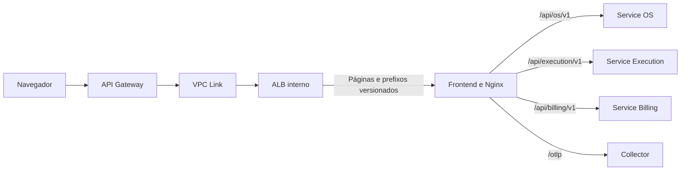

# Kubernetes — frontend e migração de infraestrutura

Esta árvore ativa contém somente os manifests do frontend migrado. Namespaces, add-ons, observabilidade e infraestrutura compartilhada pertencem ao repositório de infraestrutura. OS, Execution e Billing ainda precisam de implantação própria na nuvem.

## Pré-requisito do frontend migrado

Antes do rollout, disponibilize OS, Execution e Billing com seus bancos/Kafka/segredos e ajuste os upstreams do ConfigMap aos Services reais. Os nomes padrão são:

| Variável | Destino esperado |
| --- | --- |
| `OS_UPSTREAM` | `https://fiap-os-service.fiap-os.svc:8443` |
| `EXECUTION_UPSTREAM` | `https://fiap-execution-service.fiap-execution.svc:8443` |
| `BILLING_UPSTREAM` | `https://fiap-billing-service.fiap-billing.svc:8443` |

Esses Services não são provisionados por esta pasta. A nova imagem não usa o backend antigo. Não configure Nginx para chamar o próprio gateway que devolve a requisição ao mesmo Nginx, pois isso cria um ciclo.

Os destinos da nuvem devem terminar TLS, diretamente na aplicação ou em proxy do serviço. A porta 8443 é o contrato preparado, não uma porta TLS habilitada automaticamente nos backends atuais. O Collector também deve aceitar OTLP sobre HTTPS na porta configurada (4318). Certificados precisam incluir os nomes DNS dos upstreams no SAN.

Antes do rollout, crie no namespace `fiap-frontend` o Secret `fiap-upstream-ca`, com chave `ca.crt` contendo o bundle PEM das CAs confiáveis. Por exemplo: `kubectl create secret generic fiap-upstream-ca -n fiap-frontend --from-file=ca.crt=/caminho/ca-bundle.pem`. Use a CA real do ambiente; não versione chaves privadas. Se os destinos usarem uma CA pública, o bundle pode ser o conjunto de raízes públicas aprovado pelo ambiente. O Secret é obrigatório e sua ausência impede a criação do pod.

Nginx valida a cadeia e o hostname dos certificados, inclusive no OTLP. CA desconhecida, hostname divergente ou destino sem TLS falham com 502; não desative a verificação para contornar configuração incompleta. O Compose local continua usando HTTP em rede local, sem exigir gateway ou certificados. A [RFC-016](../docs/RFCs/RFC-016-correcao-apontamentos-sonar.md) registra a decisão e as verificações.

## Topologia preparada



Os Ingresses compartilham `fiap-edge`. `microservices-ingress.yaml` tem prioridade 5 para os três prefixos, anterior à regra `/api` legada de prioridade 10 caso ainda exista no cluster. O Ingress de páginas tem prioridade 20. A regra legada existente só deve ser retirada junto da migração de tráfego; excluir um arquivo local não a remove do cluster.

Esta topologia é configuração versionada, não evidência de deploy. API Gateway deve preservar os caminhos e encaminhar acompanhamento/decisões novos para validação do token privado no OS, sem o authorizer legado por CPF. Queries não devem aparecer em logs da borda.

## Recursos ativos

```text
k8s/
└── frontend/
    ├── config-maps.yaml
    ├── deployment.yaml
    ├── ingress.yaml
    ├── microservices-ingress.yaml
    └── services.yaml
```

Frontend usa namespace `fiap-frontend`, uma réplica Nginx sem root (UID/GID 101), porta interna 8080 e Service `ClusterIP` porta 80. O pod não monta token de ServiceAccount; o container não eleva privilégios e tem CPU, memória e armazenamento efêmero delimitados. A imagem e o ECR contêm conta/região do laboratório e tag `latest`; ajuste aos artefatos do ambiente antes do rollout. Configure também o Collector indicado no ConfigMap caso queira exportar telemetria.

Depois de provisionar e validar as dependências, os manifests podem ser aplicados pelo novo processo de deploy. O workflow antigo `deploy-applications.yml` e o orquestrador `initialize-and-deploy.yml` foram retirados: não há mais fluxo neste repositório que recrie o monólito. A publicação reutilizável da imagem frontend não substitui esse provisionamento.

## Referência legada e limites da retirada

Os seis manifests antigos estão em [legacy/aws/k8s/backend](../legacy/aws/k8s/backend), fora da árvore ativa. Servem para inventário e diagnóstico de recursos existentes; não devem ser aplicados junto dos microsserviços. O código, testes e Compose antigos estão somente no histórico Git, indicado no [guia de retirada](../docs/arquitetura/retirada-monolito.md).

Esta alteração não executou `kubectl`, Terraform, migração de dados, exclusão de bancos, volumes ou segredos. Recursos compartilhados, Lambda Authorizer e RDS exigem inventário e plano operacional antes de retirada. O workflow de destruição agendada existente permanece inalterado.

## Diagnóstico após o rollout futuro

```bash
kubectl get pods -n fiap-frontend
kubectl get ingress -n fiap-frontend
kubectl get events -n fiap-frontend --sort-by=.metadata.creationTimestamp
kubectl logs deployment/fiap-frontend-deployment -n fiap-frontend --tail=200
kubectl logs deployment/aws-load-balancer-controller -n kube-system --tail=200
```

Confira DNS e disponibilidade dos upstreams, saúde dos target groups, VPC Link e configuração dos Ingresses. Logs do acompanhamento precisam preservar o token privado. Ver [configuração frontend](../src/FIAP.TechChallenge.Fase1.Frontend/README.md), [observabilidade](../docs/operacao/observabilidade.md), [CI/CD](../docs/operacao/ci-cd.md) e [ADR-021](../docs/ADRs/ADR-021-retirada-codigo-monolito.md).
